# Rà panel bấm tay 25/11 — bảng lỗi → đã sửa + ảnh cặp trước | sau

Bấm tay mọi panel khe phải (Công việc mọi tab / loại việc; Tổng quan; Phân tích) ở các vai Head (Monbay), GV, TVV, CX, đo bằng `getBoundingClientRect`
(cột kín bề ngang, cột cuối sát phải, cột số đều, ô thẳng tâm, đầu cột thẳng mép chữ, cắt "…", tràn ngang thân panel, đỉnh panel so với thanh menu).

## Bảng lỗi → đã sửa

| Panel / màn | Cỡ màn | Lỗi | Cách sửa |
|---|---|---|---|
| Tổng quan › Chờ duyệt (panel 740) | 1440 | Dùng bộ cột 8 phần của tab (rộng 1 225 px) nên thân panel cuộn ngang, **nút Từ chối / Duyệt nằm ngoài tầm nhìn**; chiều rộng thân đúng 739 px ≥ ngưỡng 699 px của `@container` (khung 720 → 740 ở #3c061d3fa làm lọt ngưỡng) | Hai ngưỡng `@container` của `.dyc-*` 699 → 759 px (`index.css`) — panel dùng lưới 4 cột đã duyệt (tick · nội dung · ngày · nút) ở mọi bề rộng 480–759 |
| Tổng quan › Chờ duyệt | 375 | Ô tick nằm giữa cả khối 3 dòng, lệch ~3 px + 22 px so với dòng tên | `.dyc-chon` cao 19 px, dính đầu dòng — tâm tick = tâm dòng tên (±0,2 px) |
| Công việc › Đang theo dõi (và mọi nơi panel là con thứ 2 của `space-y-2`) | 1440 | Panel cách thanh menu 8 px (`margin-top` của `space-y-2` đè lên panel `fixed`) → panel không bám sát dưới thanh menu | `lg:!mt-0` trên `KhungPanel` tại chỗ (`KhungPanel.tsx`) |
| Công việc › dải tab "Thêm n ▾" khi panel mở | 1280 / 1440 | Nút "Thêm" trôi sát mép phải, hở khoảng trống ~65 px giữa tab cuối còn hiện và nút | Nút đặt ngay sau tab cuối còn hiện (`traiThem`, đo cùng lần tính tab ẩn) |
| Tổng quan › panel "MB FT 101 · Điểm thiếu" / panel theo lớp | 1440 | Nhóm đã tên "MB FT 101" nhưng mỗi dòng lặp "Lớp MB FT 101 ·" ở đầu và "MB FT 101" ở dòng phụ — chữ lặp đề mục | `PanelDsViec`: nhóm theo lớp thì bỏ phần lớp lặp ở dòng tên + dòng phụ |
| Phân tích › Tiến bộ theo kỹ năng | 1440 / 1280 | Cặp "số + %" lệch ~6 px so với tiêu đề (số nằm giữa hộp 28 px, % kề phải) | `.cap-so-giua`: cặp căn GIỮA cột, hộp số bỏ min-width / đệm — tâm mực cả cặp = tâm tiêu đề (0 px, đo 5 hàng × 3 cột) |
| Phân tích › Tiến bộ theo kỹ năng | 375 | Ô có số 0 xếp ngang ("0  0 %"), ô khác xếp dọc (số trên, % dưới) | Cùng `.cap-so-giua`: mọi ô một dòng, số + % |
| Phân tích › Giáo viên › "Tìm GV" lọc rỗng | 1440 / 1280 | Bảng chỉ còn đầu cột trắng (hàng "Chưa phân công" giữ bảng, không có trạng thái rỗng), không có "Xoá lọc" như các trang khác | Lọc rỗng → trạng thái rỗng "Không GV nào khớp" + nút **Xoá lọc** (`ChonLoc` nhận `chuGo` hai chiều, nút trả ô về trống) |

Quét 11 loại panel ở Công việc (Chốt lộ trình, Xét lại, Bàn giao, Thiếu dữ liệu, Nhập điểm, Phối hợp SOS, Báo PH, Sau thi, Case mọi bước, Theo dõi),
~35 panel số ở Tổng quan, ~15 ở Phân tích (Chi nhánh, SOS, Giáo viên, Ý thức): **không còn cột lệch, cắt "…" hay tràn ngang** ngoài các mục trên.
Dương tính giả đã loại: ô nhập điểm (đo trên hộp nhập), `sr-only`, dòng `dl` nhiều hàng, nhãn nút "Không cần theo dõi…" / "Bỏ việc…" (dấu … là quy ước mở hộp).

### Hai mục cũ "Việc để sau"
- **"PA đang chạy" theo khuôn A: đã có** — dòng dùng chung lưới con `.cvA-v` với các nhóm trên (đo: cột 41–125 · 145–336 · 356–541 · 561–642 giống hệt dòng "Ghi Mini Test").
- **"Yêu cầu của tôi" theo khuôn A: [XM]** — hiện là thẻ có trích dẫn, chip, trạng thái, "Mở ›"; đổi sang dòng 4 cột là đổi bố cục thẻ (mất đoạn trích?) — cần mockup, ghi vào plan.md.
- **Dải tab "Thêm n ▾" ở 1280**: đã sửa ở bảng trên (đặt liền tab, không còn khoảng hở).

## Ảnh cặp (trước | sau) — cả màn

| Màn | Trước | Sau |
|---|---|---|
| Tổng quan › Chờ duyệt · 1440 | 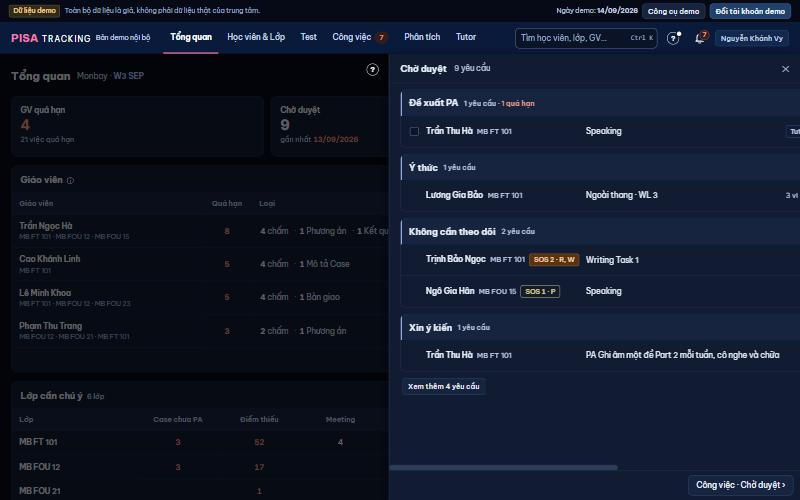 | 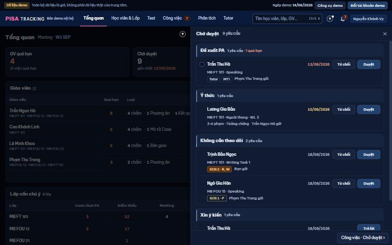 |
| Tổng quan › Chờ duyệt · 1280 (không đổi) | 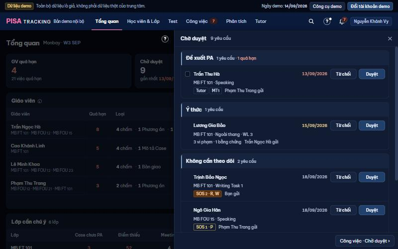 |  |
| Tổng quan › Chờ duyệt · 375 |  |  |
| Tổng quan › MB FT 101 · Điểm thiếu · 1440 | 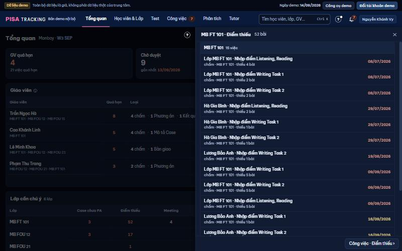 | 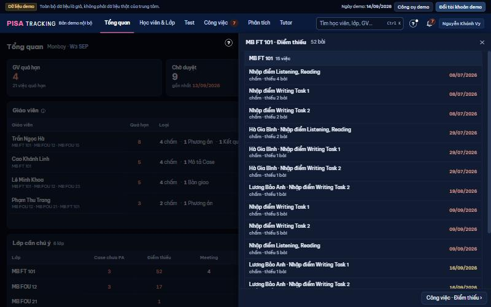 |
| Công việc › Đang theo dõi · 1440 | 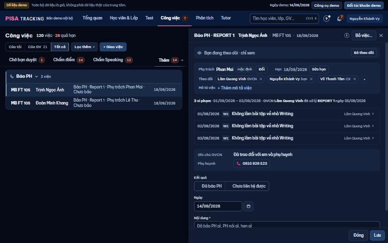 | 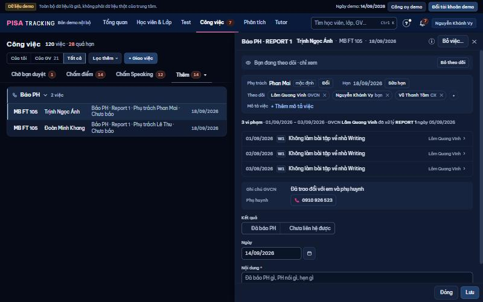 |
| Công việc › Đang theo dõi · 1280 | 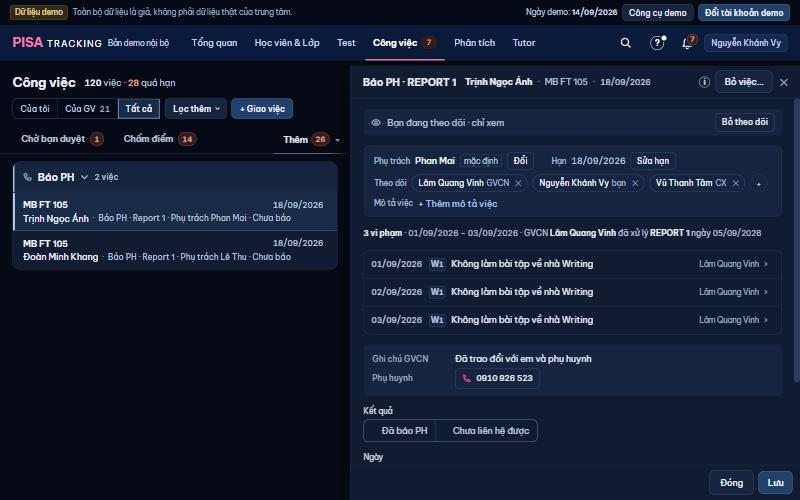 | 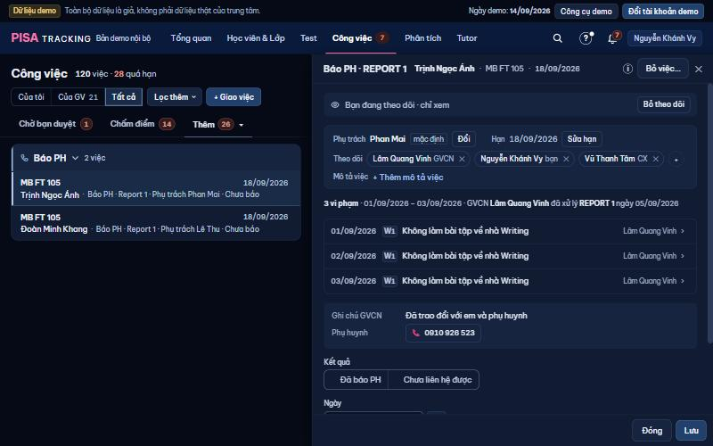 |
| Công việc › Đang theo dõi · 375 (không đổi, ở trong luồng trang) | — | 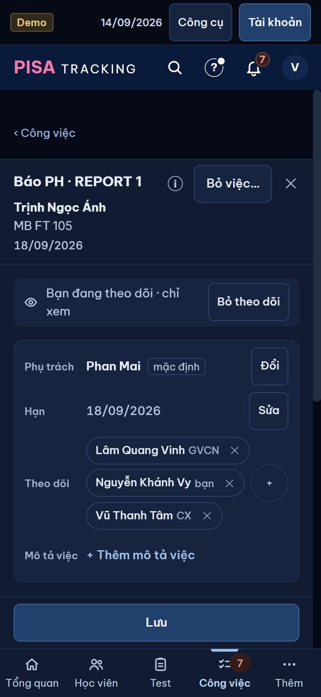 |
| Công việc › Thêm n ▾ khi panel mở · 1280 | 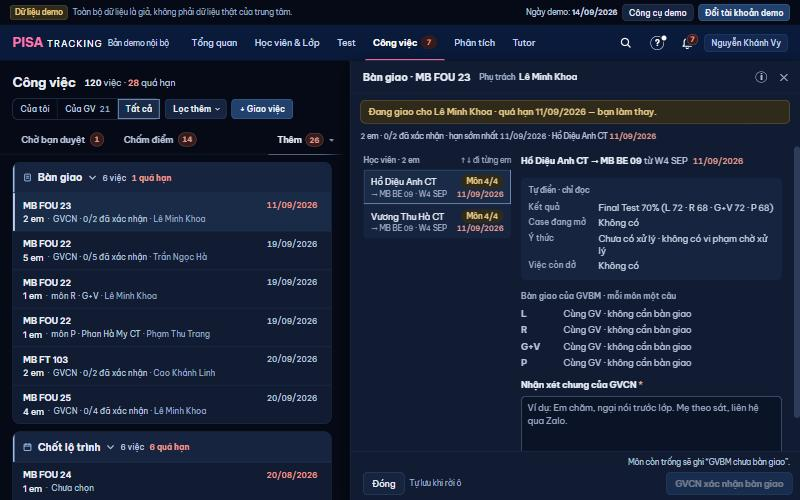 | 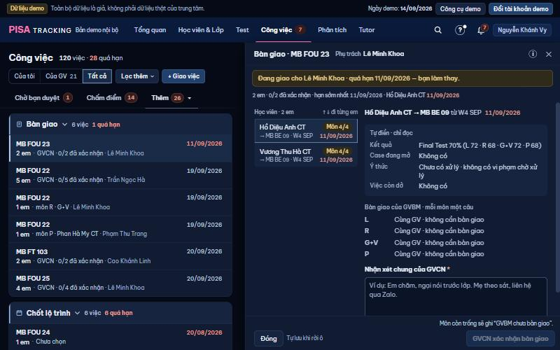 |
| Phân tích › Tiến bộ theo kỹ năng · 1440 | 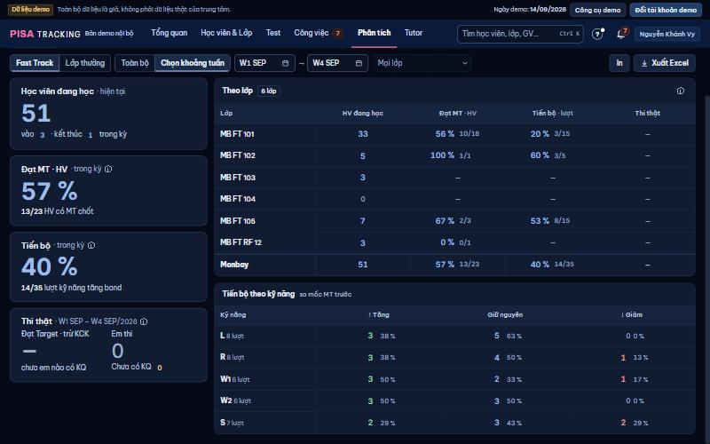 |  |
| Phân tích › Tiến bộ theo kỹ năng · 1280 | 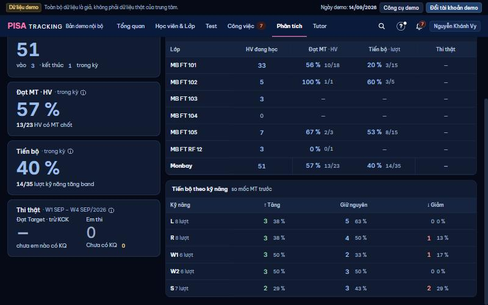 |  |
| Phân tích › Tiến bộ theo kỹ năng · 375 | 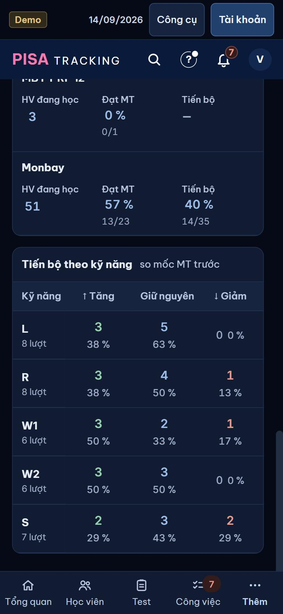 | 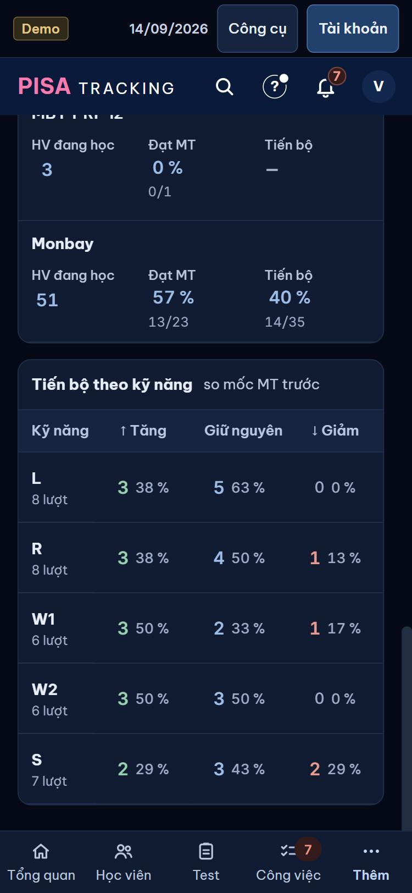 |
| Phân tích › Giáo viên › Tìm GV rỗng · 1440 | 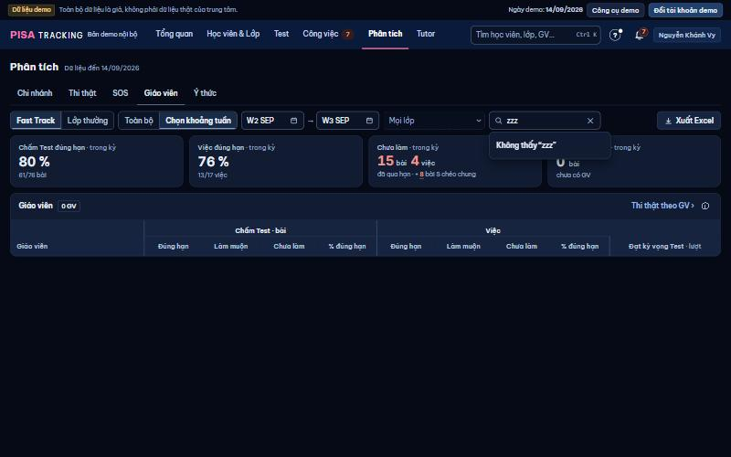 | 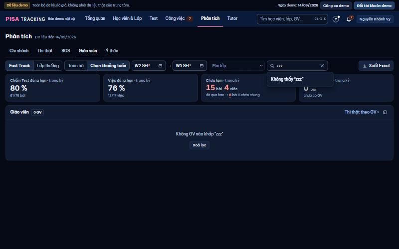 |
| Phân tích › Giáo viên › Tìm GV rỗng · 1280 | 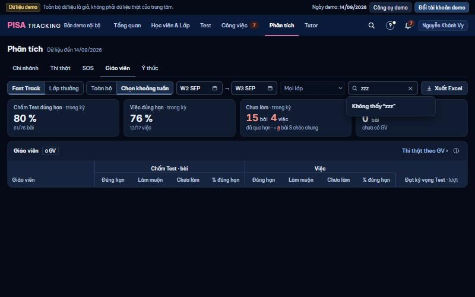 | 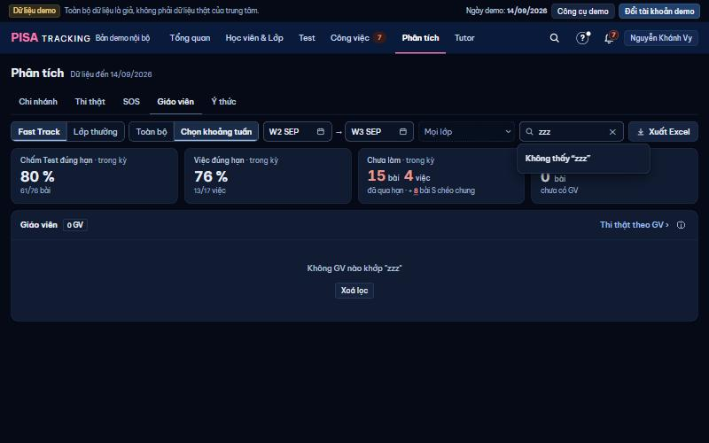 |

375 · Tìm GV: bộ chọn mở toàn màn và đóng thì xoá chữ → không có bảng rỗng; không đổi.
