# AUDIT TOÀN BỘ 16/11 — giao diện · luật · logic · workflow

Chủ SP 16/11: "Kiểm tra lại toàn bộ website, audit và đánh giá giao diện, xem có chỗ nào lỗi, chỗ nào có thể nâng cấp cho đẹp/ trực diện hơn, đề xuất dể nâng cấp và làm tốt hơn. Đồng thời kiểm tra lại toàn bộ luật lệ, logic website, chỗ chặn cứng, workflow/ bước chọn, thao tác thừa hoặc có thể rút ngắn lại."

Bản này **chỉ rà + đề xuất, không sửa mã**. Mã: `main` 62fd07033 (sau #1777). Seed, ngày demo 14/09/2026. Ảnh chỉ tài khoản demo, tên giả.

## 0. Tóm tắt một trang

**Đếm (sau khi gộp trùng giữa các nhóm):** P0 **0** · P1 **16** · P2 **khoảng 100**. Trong đó 12 câu hỏi cho chủ SP (mục 5).

**Không có P0.** Đã thử quyền bằng API với 13 tài khoản: không vai nào ghi được ngoài quyền, không đọc / ghi chéo chi nhánh ngoài 3 ngoại lệ đã chốt. Không lỗi console, không request lỗi ở các màn / panel đã mở (trừ 403 / 404 cố ý thử). Lưu xong việc nào thì máy chủ thôi báo chờ ngay ở mọi nơi đã đo (14 nơi, 8 loại thao tác).

**Ba việc nên làm trước (đều nhỏ, không cần mockup, không tăng đọc Turso):**
1. **Số việc phải cùng một nguồn.** Cùng một lớp, cùng một người mà ba màn ra ba số; số "bài" ở đầu trang Công việc sai; hồ sơ HV thiếu việc so với Công việc; cùng một GV ra ba bộ % ở ba trang. → P1-01 … P1-08. Đây là chỗ làm người dùng mất tin vào con số nhiều nhất.
2. **Còn sót vài chỗ một chiều.** Cuối khoá chốt cả lớp "Ngay hôm nay" không Hoàn tác; xoá lớp trống là xoá hẳn; vài câu chặn không nói bước tiếp. → P1-09 + mục 4A. Thêm: "+ Lớp mới" tạo xong lớp nhưng hộp vẫn hỏi "Bỏ chữ đang gõ?" → P1-16.
3. **Chữ nói sai luật / sai người.** Hộp "Báo tình hình" ghi gửi Quản lý trong khi gửi TVV; panel Ghi kết quả PA có hai câu trái nhau; số ngày hạn ghi cứng lệch Hạn mặc định. → P1-11, P1-13 + mục 4D.

**Bốn câu cần chủ SP quyết trước (chi tiết + 8 câu nhỏ ở mục 5):**
1. Em đã có kết quả thi thật, đang chờ bước tiếp: có **tạm ẩn** việc Case / PA / MT của em khỏi Công việc của GV không? *(khuyến nghị: có)*
2. Thêm học viên vào lớp đã chạy: tuần bắt đầu mặc định là **tuần hiện tại** thay vì tuần khai giảng? *(khuyến nghị: có — nay sinh "MT cũ chưa có điểm" cho em mới vào)*
3. GV không dạy em (cùng chi nhánh) có được **xem** hồ sơ em không? Mockup ③ vẽ có, web đang chặn. *(khuyến nghị: giữ chặn, sửa mockup)*
4. Báo cáo PH quá hạn hơn 7 ngày tự rời Công việc của GV (đã chốt) — có thêm **một dòng nhắc cho QL** không? *(khuyến nghị: có)*

**Cách đọc cột "Rà":** ✓ = PTA Audit đã tự đọc lại mã / đo lại / xem ảnh · ○ = nhóm con báo kèm ảnh hoặc file:dòng, chưa rà lại lần hai.
**Loại:** LỖI = lỗi đã kiểm · ĐX = đề xuất · HỎI = câu hỏi cho chủ SP.

## 1. Cách làm

- **6 nhóm song song** (Opus 5.5 · high), mỗi nhóm 2 vòng, mỗi nhóm một tệp chi tiết có ảnh + file:dòng:
  [a1](chi-tiet/a1.md) GV · GVCN · GV Speaking · [a2](chi-tiet/a2.md) QL + Quản trị · [a3](chi-tiet/a3.md) TVV · Admin · CX · Head tutor · hồ sơ HV · Hướng dẫn ·
  [b1](chi-tiet/b1.md) chặn cứng · đường lui · quyền · [b2](chi-tiet/b2.md) số liệu cùng nguồn · [b3](chi-tiet/b3.md) 12 workflow đếm bước.
- **Bấm thử thật** bằng Playwright trên hai máy chủ demo: một bản seed nguyên chỉ đọc, một bản chép được ghi (thử lưu / xoá / hoàn tác / duyệt). Khoảng 18 tài khoản demo, đủ 7 vai (GV tách GVCN · bộ môn · Speaking). Cỡ 1440 tối + 375 sáng mọi màn; 1440 sáng + 375 tối + 1280 cho màn chính.
- **Skill đã chạy thật:** `impeccable` critique + audit (3 nhóm giao diện: critique 27–29 / 40, audit 13–15 / 20 — chạy rút gọn trong một ngữ cảnh) · `ui-ux-pro-max` · `web-design-guidelines` · `karpathy-guidelines`. Skill gợi ý trái luật thì bỏ (vd "Title Case cho nút", "bullet chart cho KPI", "hộp xác nhận trước khi xoá").
- **PTA Audit tự rà lại** mọi P1 và các P2 nặng trước khi đưa vào đây. Đã **loại 2 mục báo sai**, **hạ / sửa 2 mục** và giải một nghi vấn chung:
  - A1-18 "Kết thúc PA bắt gõ hai ô chữ" — sai: Kết luận tự lấy từ Nhận xét, mức điền sẵn, đúng mockup ⑫.
  - A2-24 "QL mở việc chấm của GV khác vào thẳng lưới" — đúng theo chủ SP 10/11 (#1273), không phải lỗi.
  - A1-16 "GVCN lưu được điểm W1 của GV khác ở MT cũ" — quyền ĐÚNG theo luật T22 (MT cũ: QL + GVCN lớp đó sửa được); chỉ còn lỗi hiển thị (mục 4C).
  - A3-17 "Head tutor như GV chưa làm" — đã merge #1582; còn lại là câu hỏi (mục 5).
  - "Trang gọi `/my-work` hai lần" (3 nhóm cùng nghi) — do `React.StrictMode` của bản dev, bản chính không có.
- **Chưa rà được:** khoá cuối tuần N15 (ngày demo là thứ Hai — mới đọc mã, đúng luật) · bàn phím ảo trên điện thoại thật · panel Meeting CX / GĐCN của TVV và nút "Thu hồi" (seed không có việc) · lưới Ghi kết quả PA theo lớp (seed không có dòng gộp) · Kết quả đầu ra / Kỳ vọng FT · lịch MT của em chuyển lớp sau tuần chuyển (ngày demo cố định) · nút "Chèn" ở Báo cáo PH (không em nào có câu nguồn) · sửa tại ô ở Quản trị › Chương trình / Case & SOS / Hạn mặc định · Tutor, KET-PET (hoãn).

## 2. P0 — không có

## 3. P1 — 16 vấn đề

### Nhóm A · Con số không cùng nguồn (8)

**P1-01 · Việc của cùng một lớp ra ba số** — LỖI ✓ · [A1-02](chi-tiet/a1.md) = [B2-01](chi-tiet/b2.md) (hai nhóm tìm độc lập)
- **Thấy:** GVCN (tài khoản 7), lớp MB FT 101. Công việc › Lớp của tôi: "Case · 7 · Ý thức · 5". Hồ sơ lớp: "Case · 14 · Ý thức · 7". HV & Lớp: "Case · 14 · Ý thức · 7". Ngay trong dải hồ sơ lớp, số "n việc" cũng không bằng tổng các chip.
  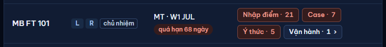 
- **Vấn đề:** trái V13 (một DÒNG việc = 1, mọi nơi một hàm). Hai màn sau đếm từng em, màn đầu đếm dòng gộp.
- **Đề xuất:** dải hồ sơ lớp và chip hàng lớp ở HV & Lớp đếm theo dòng gộp như Công việc. Một sửa, ba nơi cùng số.
- **Mockup:** không · **PR:** nhỏ (`ThanhViecLop.tsx`, `StudentsPage.tsx`, `viecTheoEm.ts`) · **Turso:** 0.

**P1-02 · Số "bài" sai ở đầu trang Công việc và tab Chấm Speaking** — LỖI ✓ · [A1-01](chi-tiet/a1.md) = [B2-04](chi-tiet/b2.md) · [A3-06](chi-tiet/a3.md)
- **Thấy:** GVCN 7 đầu trang "34 bài", các dòng cộng lại 38. Admin: Công việc "83 bài" ↔ Tổng quan "Bài chưa nhập điểm 105". Tab Chấm Speaking ghi 7 bài, thật có 18 (12 quá hạn). GV Speaking 21: "19 bài" khi tab Chấm điểm chỉ có 1 bài.
  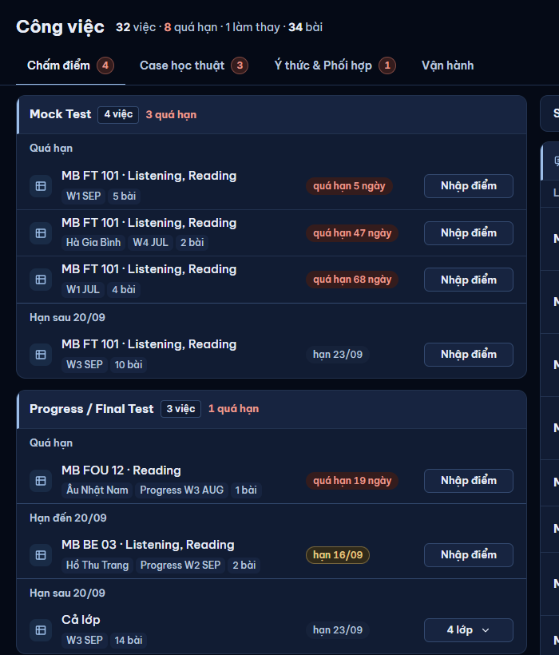
- **Vấn đề:** dòng gộp nhiều lớp giữ số bài của lớp con đầu tiên (`shared/domain/gopViec.ts:150`); đầu trang còn cộng cả bài Chấm Speaking (lời 33, 45: không cộng).
- **Đề xuất:** dòng gộp mang tổng bài của các lớp con (sửa một chỗ, mọi nơi cộng tự đúng) và **bỏ "· n bài" khỏi đầu trang** — mockup ① đã duyệt chỉ có "14 việc · 9 quá hạn", số bài đã ở từng dòng.
- **Mockup:** không · **PR:** nhỏ (`gopViec.ts`, `HoTroHocVienTab.tsx` + phép kiểm "tổng dòng = tổng lá") · **Turso:** 0.

**P1-03 · Việc làm thay bị đếm vào hồ sơ GV và đầu tab** — LỖI ✓ · [B2-05](chi-tiet/b2.md) = [A1-15](chi-tiet/a1.md)
- **Thấy:** hồ sơ GV Trần Ngọc Hà "Việc đang tồn 33" ↔ Công việc của chính cô "32 việc · 1 làm thay". Cùng một việc (Mini Test của thầy Khoa) được cộng vào hồ sơ của ba GV. Tab Case ghi "trong 13 việc", chuông ghi 12.
- **Vấn đề:** hồ sơ GV và đầu tab không lọc "việc của mình" như badge (`giaoVien/hoSo.ts:39`). QL nhìn tải việc của GV bị phồng.
- **Đề xuất:** hai nơi đếm như badge: chỉ việc của người đó; dòng làm thay vẫn hiện, ghi riêng "· 1 làm thay".
- **Mockup:** không · **PR:** nhỏ (`hoSo.ts`, `HoTroHocVienTab.tsx`) · **Turso:** 0.

**P1-04 · Thanh "Việc cần làm" ở hồ sơ HV thiếu việc so với Công việc** — LỖI ✓ · [B2-06, B2-07](chi-tiet/b2.md)
- **Thấy:** so 47 em của GVCN 7: 12 em lệch (vd Lý Minh Châu: Công việc 3 việc ↔ hồ sơ 1 việc; thiếu cả nhóm Phối hợp SOS). TVV 27 mở hồ sơ em đang có việc Báo PH hạn 18/09: không có thanh việc nào.
  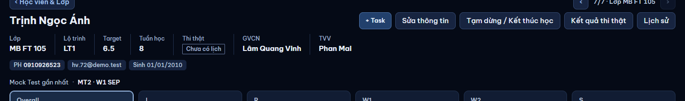
- **Vấn đề:** hồ sơ HV dựng việc bằng một hàm riêng (`students/viecHocVien.ts`), không đọc Phối hợp SOS, Báo PH vi phạm, Bổ sung hồ sơ.
- **Đề xuất:** thêm ba nguồn đó vào hàm của hồ sơ HV, cùng khoá với Công việc, kèm phép kiểm so hai đường. KHÔNG gọi `/my-work` từ hồ sơ.
- **Mockup:** không · **PR:** vừa (`viecHocVien.ts` + phép kiểm) · **Turso:** + 1–2 câu mỗi lần mở hồ sơ HV (cảnh báo: đường `/students/:id` đang 63–70 câu).

**P1-05 · Cùng một GV ra ba bộ số ở ba trang** — LỖI ✓ · [B2-02](chi-tiet/b2.md) = [A2-02](chi-tiet/a2.md)
- **Thấy:** QL xem Trần Ngọc Hà. Tổng quan: Việc 67 % · Chấm 71 %. Bấm tên sang Hồ sơ GV: 76 % · 92 %. Phân tích GV: 80 % · 75 %.
  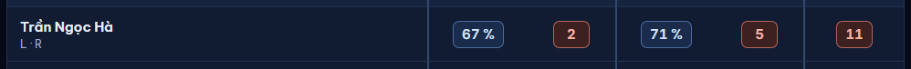 
- **Vấn đề:** ba trang mặc định ba kỳ khác nhau, link tên GV không mang kỳ sang (mã ghi chú là có truyền, thật không truyền — `TongQuanV5.tsx:352`, `PhanTichGiaoVien.tsx:111`). Trái mockup hồ sơ GV H4 "kỳ đi theo trang nguồn".
- **Đề xuất:** link tên GV mang `tu` / `den` của trang nguồn; Tổng quan và Phân tích GV dùng chung một kỳ mặc định.
- **Mockup:** không · **PR:** nhỏ · **Turso:** 0.

**P1-06 · Ô "Case chưa có PA" ở Tổng quan đếm thừa** — LỖI ✓ (phần em Tạm dừng: ○) · [A2-01](chi-tiet/a2.md) · [B2-14, B2-16](chi-tiet/b2.md)
- **Thấy:** ô ghi 38, panel của chính ô đó ghi "Chưa có PA · 36" + "Chờ kết quả cuối 2" (2 Case này đã có PA). Em Tạm dừng: việc, SOS giảm đúng, riêng ô này vẫn đếm Case của em. Tên: Tổng quan "Chưa có PA" ↔ Phân tích SOS "Chưa chốt PA".
  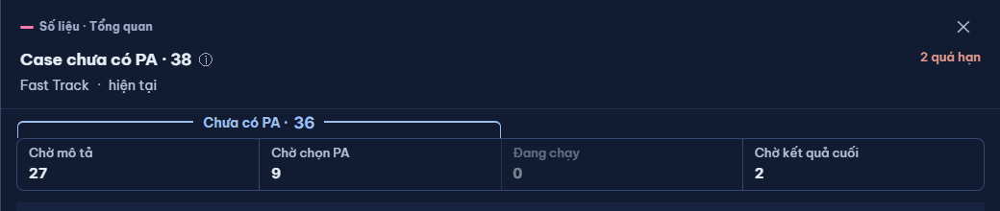
- **Vấn đề:** ô vẫn đếm tập cũ "Case chưa chốt PA" (`tongQuanV5.ts:76,91`); trái G7 (số trên ô = số dòng panel) và lời 40.
- **Đề xuất:** ô, cột lớp, cột chi nhánh đếm đúng tập "chờ mô tả + chờ chọn PA" của em đang học; một tên "Chưa có PA" ở mọi nơi.
- **Mockup:** không · **PR:** nhỏ (`tongQuanV5.ts`, `bangChiNhanh.ts`) · **Turso:** 0.

**P1-07 · QL bấm ô số ở hồ sơ lớp ra trang không khớp số** — LỖI ✓ · [B2-12, B2-13](chi-tiet/b2.md)
- **Thấy:** hồ sơ lớp FT 101, QL bấm "Quá hạn của lớp · 14 ›" → HV & Lớp ghi "0 HV · Không có học viên nào khớp". Bấm "Chờ chấm · 65 ›" → Lịch Test không có số 65 nào (chỉ "Quá hạn 36").
  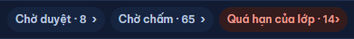 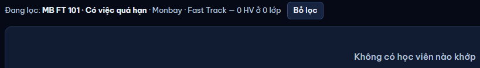
- **Vấn đề:** ô đếm việc của mọi người, trang đích chỉ lọc việc của người xem. Trái G7, V11.
- **Đề xuất:** ô "Quá hạn của lớp" của QL dẫn tới Công việc › Tất cả, lọc sẵn lớp + Quá hạn; ô "Chờ chấm" hiện đúng số mà Lịch Test hiện được.
- **Mockup:** không · **PR:** nhỏ (`DauTrangLop.tsx`) · **Turso:** 0.

**P1-08 · Phân tích › Ý thức: thẻ ghi 10, bảng cộng ra 11** — LỖI ✓ · [B2-03](chi-tiet/b2.md)
- **Thấy:** thẻ "Chưa xử lý 10 vi phạm"; bảng "Học viên cần chú ý" có Quách Thành Nam "Vi phạm 0 · Chưa xử lý 3", cộng cả bảng ra 11.
  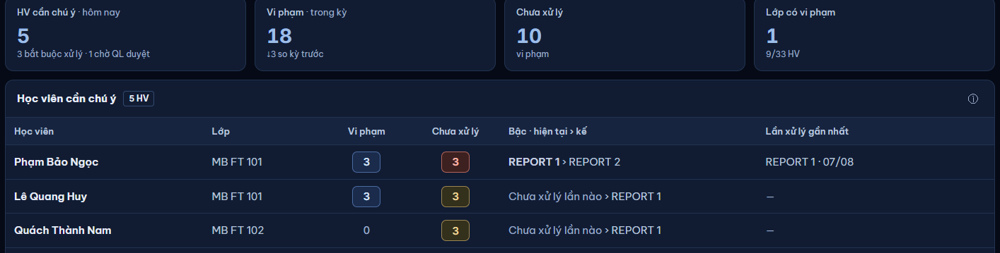
- **Vấn đề:** thẻ và bảng lớp chỉ đếm vi phạm xảy ra trong kỳ, bảng học viên đếm mọi vi phạm còn mở.
- **Đề xuất:** "Chưa xử lý" = hiện tại ở cả ba chỗ (như Công việc), nhãn ghi "· hiện tại"; "trong kỳ" chỉ dùng cho cột Vi phạm.
- **Mockup:** không · **PR:** nhỏ (`yThucPhanTich.ts`) · **Turso:** 0.

### Nhóm B · Đường lui, nhập liệu, chữ sai (6)

**P1-09 · Cuối khoá chốt cả lớp "Ngay hôm nay" không có Hoàn tác** — LỖI ✓ · [B1-01](chi-tiet/b1.md)
- **Thấy:** QL chốt lộ trình cả lớp với tuần "Ngay hôm nay": một hộp xác nhận, rồi em sang lớp mới luôn. Muốn sửa phải chuyển lớp ngược từng em.
- **Vấn đề:** PTA đã quyết 07/11 ("KHẨN: mở mọi chặn cứng") thêm Hoàn tác cho chuyển ngay; mới làm cho đường chuyển một em, sót đường cả lớp (`routes/index.ts:2044`).
- **Đề xuất:** bọc đường cả lớp bằng cùng cơ chế Hoàn tác của đường một em; toast "Đã chuyển n em · Hoàn tác"; khi đã có Hoàn tác thì bỏ hộp xác nhận.
- **Mockup:** không · **PR:** nhỏ–vừa · **Turso:** 0 đọc.

**P1-10 · Nhập điểm Progress từ việc một em: ô "Tổng số câu" trống** — LỖI ✓ · [B3-01](chi-tiet/b3.md)
- **Thấy:** GVCN mở việc "MB BE 03 · Hồ Thu Trang · Progress W2 SEP": hàng Tổng số câu L, R trống. Bấm "Cả lớp" thì hiện 20 / 20.
  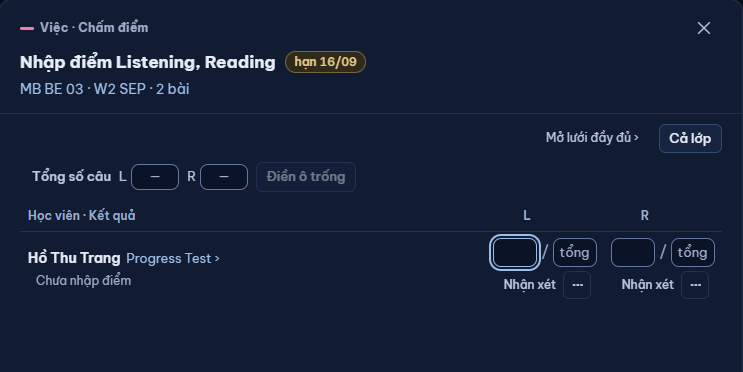 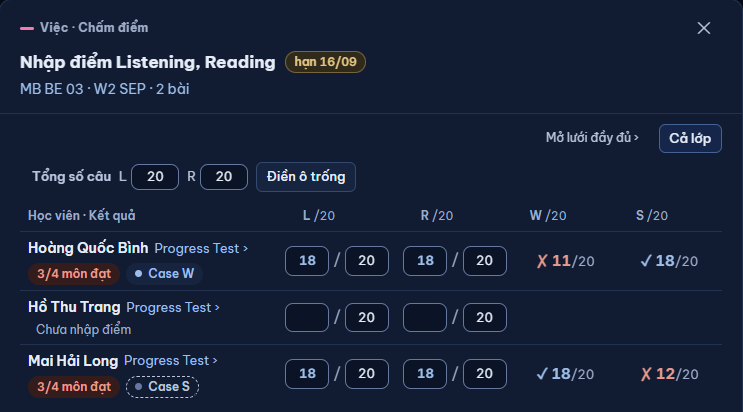
- **Vấn đề:** panel lọc hàng theo việc rồi mới tính tổng mặc định (`LuoiChamLop.tsx:121`) → GV gõ lại 2 ô mỗi môn; gõ nhầm tổng là sai % đạt.
- **Đề xuất:** tính tổng mặc định trên cả lớp, không phải trên hàng đã lọc. Việc một em: 4 ô → 2 ô.
- **Mockup:** không · **PR:** nhỏ (`LuoiChamLop.tsx`, `LuoiThuong.tsx`, `MotKyNang.tsx`) · **Turso:** 0.

**P1-11 · Hộp "Báo tình hình" ghi sai người nhận** — LỖI ✓ · [B3-02](chi-tiet/b3.md)
- **Thấy:** hồ sơ HV › tab Ý thức › "Báo tình hình": hộp ghi "Gửi tới **Quản lý chi nhánh**" dù em có TVV Phan Mai; nút lại ghi "Gửi TVV". Máy chủ gửi đúng TVV.
  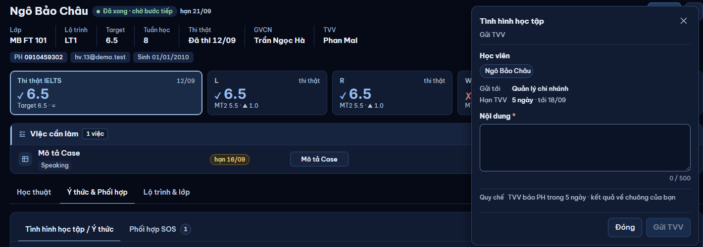
- **Vấn đề:** lối này truyền thiếu tên TVV (`StudentYThucSection.tsx:295`); lối từ hồ sơ lớp thì đúng. GV hiểu sai ai nhận việc.
- **Đề xuất:** truyền tên TVV đã có ở đầu hồ sơ; chỉ ghi "Quản lý chi nhánh" khi em thật sự chưa có TVV.
- **Mockup:** không · **PR:** nhỏ · **Turso:** 0.

**P1-12 · Tổng quan QL ở màn 1280: bảng "Lớp cần chú ý" giấu cột** — LỖI ✓ · [A2-03](chi-tiet/a2.md)
- **Thấy:** ở 1280 cột "Thi tháng này" bị giấu (không có dấu cuộn), tên GVCN cắt "Trần Ngọ…"; ở 1440 ô SOS bị xén cạnh phải.
  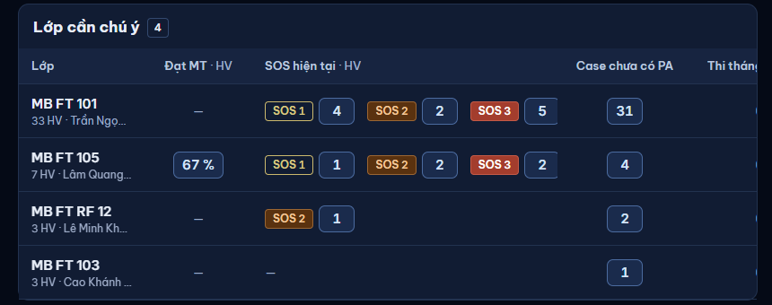
- **Vấn đề:** laptop QL thường 1280–1366; cột bị giấu là mất thông tin; chữ bị cắt "…".
- **Đề xuất:** cột SOS giãn theo nội dung, dòng phụ dưới tên lớp cho xuống dòng; mục tiêu 1280 không cuộn ngang. Giữ bố cục.
- **Mockup:** không · **PR:** nhỏ (`TongQuanV5.tsx`) · **Turso:** 0.

**P1-13 · Panel Ghi kết quả PA: hai câu trái nhau về "kết thúc sớm"** — LỖI ✓ · [A1-03](chi-tiet/a1.md)
- **Thấy:** cùng một panel (PA quy chế): câu tĩnh "…GVCN / QL **kết thúc sớm** bằng 'Kết thúc sớm…' ở thẻ PA. Cần thêm hỗ trợ?" và dòng quy chế "PA quy chế: không thay, **không kết thúc sớm**". Mở từ Công việc thì câu "Cần thêm hỗ trợ?" không có nút đi kèm.
  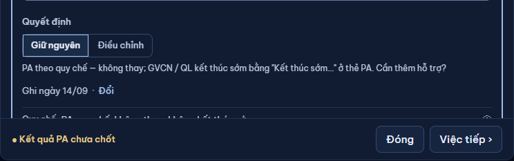
- **Vấn đề:** người dùng không biết có được kết thúc sớm không; câu tĩnh trái luật "bỏ chú thích".
- **Đề xuất:** bỏ câu tĩnh; dòng quy chế ghi một câu đúng theo vai (GV bộ môn: "không thay, không kết thúc sớm" · GVCN / QL: "… · kết thúc sớm ở thẻ PA"), chi tiết vào ⓘ.
- **Mockup:** không · **PR:** nhỏ (`CapNhatTuan.tsx`, `quyCheCase.ts`) · **Turso:** 0.

**P1-16 · "+ Lớp mới": tạo xong lớp nhưng hộp vẫn báo chưa lưu** — LỖI ✓ · [B3-12](chi-tiet/b3.md)
- **Thấy:** QL bấm "Tạo lớp" → toast "Đã tạo lớp MB FT 88", lớp đã có trong danh sách, nhưng hộp không đóng: ô Số lớp đỏ "Đã có lớp MB FT 88", chân "Còn 1 ô cần sửa ↑", rồi hộp "Bỏ chữ đang gõ? · Tạo lớp mới chưa lưu". Tái hiện 2 lần.
  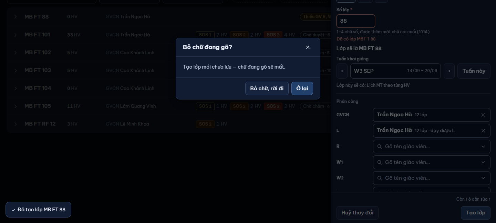
- **Vấn đề:** báo sai trạng thái (đã lưu mà nói chưa lưu); người dùng dễ đổi số rồi tạo thêm một lớp thừa. Gốc: sau khi lưu, form vẫn bị coi là đang sửa nên lệnh chuyển sang hồ sơ lớp bị chặn (`ClassCreatePanel.tsx:123-126`).
- **Đề xuất:** đánh dấu form đã lưu ngay khi máy chủ trả về rồi mới đóng / chuyển trang; không so "trùng" với chính lớp vừa tạo.
- **Mockup:** không · **PR:** nhỏ (`ClassCreatePanel.tsx`) · **Turso:** 0.

### Nhóm C · Lệch mockup đã duyệt + câu hỏi (2)

**P1-14 · Hồ sơ HV ở vai TVV / CX / Admin: hàng nút rời** — LỖI ✓ · [A3-03](chi-tiet/a3.md)
- **Thấy:** TVV thấy 5 nút rời "+ Task · Sửa thông tin · Tạm dừng/ Kết thúc học · Kết quả thi thật · Lịch sử"; ở 375 thành ba hàng nút (~150 px) trước dòng thông tin. Nút "Kết quả thi thật" hiện cả khi em "Chưa có lịch" thi.
  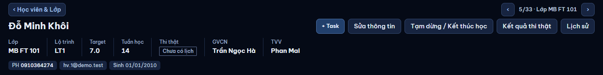 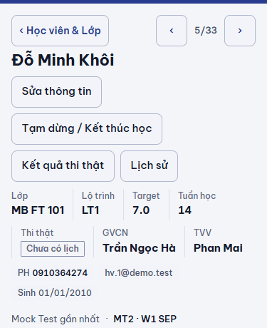
- **Vấn đề:** mockup ③ đã duyệt (lời 28) vẽ TVV chỉ có "+ Task" và "⋯"; trái lời 40 (thông tin theo trạng thái).
- **Đề xuất:** mọi vai một dáng "+ Task" + "⋯"; giữ đủ mục, chỉ đổi chỗ.
- **Mockup:** không (đã vẽ) · **PR:** nhỏ (`StudentDetailPage.tsx`) · **Turso:** 0.

**P1-15 · Em đã có KQ thi thật vẫn sinh việc Case cho GV** — HỎI ○ · [B3-03](chi-tiet/b3.md) → câu 1 mục 5
- **Thấy:** lưu KQ thi thật (đạt Target) cho Ngô Bảo Châu → hồ sơ "chờ bước tiếp, hạn 21/09"; GVCN vẫn có 2 việc "Mô tả Case" hạn 16/09, GV Speaking cũng có; hồ sơ còn 5 Case "Chờ mô tả".
  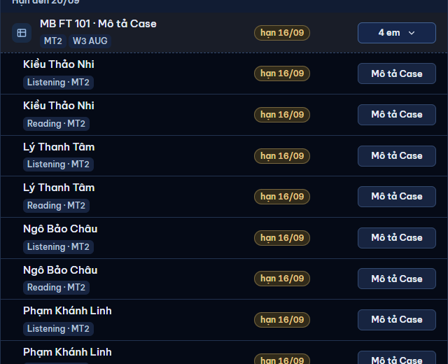
- **Vấn đề:** việc không còn ảnh hưởng đầu ra mà vẫn đòi 5 GV làm. Luật "thi thật không tự kết thúc" nên máy chưa đóng.
- **Đề xuất:** em có KQ thi thật → việc Case / PA / MT của em **tạm ẩn** khỏi Công việc (như em Tạm dừng), không xoá; TVV chọn "Lộ trình mới" thì hiện lại. Không đổi luật kết thúc.
- **Mockup:** không · **PR:** vừa (`mywork.ts`, `viecHocVien.ts`) · **Turso:** 0.

## 4. P2 — theo khu

Mỗi dòng: màn · vai → thấy gì → đề xuất. Chứng cứ đầy đủ (ảnh, file:dòng, số đo) ở tệp chi tiết theo mã. Mọi dòng **Turso 0** trừ khi ghi khác.

### 4A. Chặn cứng · đường lui · xác nhận thừa

| Mã | Rà | Loại | Hiện trạng đã kiểm | Đề xuất + lý do | Mockup | PR |
|---|---|---|---|---|---|---|
| B1-02 | ✓ | LỖI | Hồ sơ lớp › Xoá lớp trống (QL): xoá hẳn, bắt gõ lại mã lớp, không Thùng rác — trái lời 32 ("có Thùng rác 30 ngày") | Xoá lớp trống đi qua Thùng rác + toast Hoàn tác; bỏ ô gõ mã (như xoá HV) | không | nhỏ |
| B1-05 | ✓ | LỖI | Kế hoạch Test › S Expert (QL): nhập điểm trước tuần → 400 "Chưa tới tuần…"; Mock / MT0 thì tự dời về tuần này | Tự dời lượt S Ex về tuần này như Mock (có lịch sử) — sót khi bỏ chặn 14/11 | không | nhỏ |
| B1-06 | ✓ | LỖI | Khôi phục bài lớp thường đã huỷ khi lớp đã kết thúc: chặn, câu "xem ở Lịch sử" không phải đường làm | Hỏi một câu "Lớp đã kết thúc — Mở lại lớp để khôi phục?" như Phân công / Kết thúc lớp | không | nhỏ |
| B1-07 | ✓ | LỖI | Sửa Case › đổi kỹ năng khi Case đã có PA: chặn, không bước tiếp; đường vòng là xoá rồi tạo lại (mất lịch sử) | Cho đổi, PA đi theo, hỏi một câu nêu số PA, ghi lịch sử | không | nhỏ |
| B1-09 | ✓ | LỖI | Công việc TVV › Chốt ngày thi: lưu xong mọi ô khoá, chỉ còn "Đóng"; sửa phải sang Lịch thi | Sau lưu ô vẫn sửa được (lưu lại = sửa, có lịch sử) | không | nhỏ |
| A2-23 | ○ | LỖI | Chuyển lớp một em (lệnh chờ) và Duyệt đề xuất chuyển lớp: toast không có "Hoàn tác"; mọi loại duyệt khác đều có | Toast có "Hoàn tác" gọi đúng đường "Huỷ quyết định" đang có ở hồ sơ | không | nhỏ |
| B1-10 | ○ | ĐX | Xoá vi phạm: hộp "Xoá vi phạm này?" RỒI mới toast Hoàn tác + Thùng rác — hai lớp cho một lần xoá | Bỏ hộp, xoá thẳng + Hoàn tác (như xoá Case / PA) | không | nhỏ |
| B1-11 | ○ | ĐX | Quản trị › Xoá tài khoản: phải gõ lại email dù là xoá mềm, khôi phục được | Bỏ ô gõ lại; giữ câu hậu quả + Hoàn tác | không | nhỏ |
| B1-14 | ○ | LỖI | 5 câu chặn không nói bước tiếp (vd "Quyết định đã thi hành — không khôi phục được"; QL nhập điểm lớp chi nhánh khác nhận câu dành cho GV) | Mỗi câu thêm đường làm ("→ Chuyển lớp lại từ lớp hiện tại"…) | không | nhỏ |
| A1-21 | ○ | LỖI + HỎI | Khai / sửa cấp bậc: mục menu và tên panel khác nhau; nút bậc viết tắt R1 / WL1; câu "xác nhận một lần, chỉ QL sửa sau" | Tên panel = tên mục; nút bậc viết đủ; phần "chỉ QL sửa sau" → câu 8 mục 5 | không | nhỏ |

### 4B. Bớt bước · bớt tìm đường

| Mã | Rà | Loại | Hiện trạng đã kiểm | Đề xuất + lý do | Mockup | PR |
|---|---|---|---|---|---|---|
| B3-05 | ○ | ĐX | Panel Case chưa có nguyên nhân: gõ mô tả → bị nhắc → "Sửa nguyên nhân" → chọn → "Xong" (6 bấm) | Hàng chip nguyên nhân mở sẵn, chọn là lưu luôn → 4 bấm | không | nhỏ |
| B3-06 | ○ | ĐX | Xác nhận xử lý vi phạm: ô "Mô tả *" gõ tay dù vi phạm + bậc đã hiện ngay trên | Nút "Chèn" (cùng kiểu bàn giao đã duyệt) điền "REPORT 1 · {vi phạm}", sửa được | không | nhỏ |
| B3-07 | ○ | ĐX | Ghi vi phạm: chọn Nhóm rồi vẫn gõ tay ô "Vi phạm *" | 2–3 chip câu hay dùng theo Nhóm, bấm là điền | không | nhỏ |
| B3-08 | ○ | ĐX | QL / Admin nhập hộ Speaking: gõ xong 4 tiêu chí, bấm Lưu mới bị báo "chọn GV chấm", con trỏ không tới ô đó | Mở hộp đặt con trỏ ở ô Người chấm khi còn trống; lỗi lúc Lưu focus đúng ô. Luật giữ nguyên | không | nhỏ |
| B3-10 | ○ | ĐX | Công việc › "Viết ›" Báo cáo PH: sang trang bảng, phải tự tìm ô "–" của mình | Link tự mở panel viết ở em đầu còn thiếu (−1 bấm, 0 tự tìm) | không | nhỏ |
| B3-11 | ○ | ĐX | QL đổi GV một kỹ năng: ⋯ › Thông tin lớp › Phân công › Sửa… = 7 bấm; dải GV đầu trang chỉ mở thẻ xem | QL bấm ô GV trong thẻ dải → hộp chọn GV + hiệu lực (dùng lại hộp sẵn có) → 4 bấm | không | nhỏ–vừa |
| A2-11 | ○ | ĐX | Công việc QL mở mặc định tab "Chờ bạn duyệt" (1 quá hạn) trong khi "Việc quản lý" có 6 quá hạn; ở 375 tab đó bị đẩy khỏi màn | Tab mặc định = tab có nhiều việc quá hạn nhất của người xem | không | nhỏ |
| A2-12 | ○ | ĐX | Công việc QL: đổi sang "Của GV" vẫn ở tab Chờ bạn duyệt với đúng danh sách của QL | Đổi phạm vi thì chuyển sang tab đầu có việc của GV | không | nhỏ |
| A2-13 | ○ | ĐX | Lịch Test (lớp thường): nút "Tạo bài kiểm tra theo chương trình" luôn hiện; bấm chỉ báo "đã có đủ bài" | Chỉ hiện khi còn em thiếu bài, chữ "Tạo bài còn thiếu" | không | nhỏ |
| A1-09 | ○ | ĐX | Hồ sơ lớp FT (GV): ba lối vào Nhập điểm, số 21 hiện hai lần cách nhau 40 px | Bỏ "Chờ chấm · 21 ›" ở dải số với GV (chip Việc cần làm đã có) | không | nhỏ |
| A2-18 | ○ | ĐX | HV & Lớp: menu ⋯ đầu trang chỉ có một mục "+ Lớp mới" | Thay bằng nút "+ Lớp" cạnh "+ Thêm học viên" | có (sửa mockup ⑥ K2) | nhỏ |
| B3-13, B3-14 | ○ | LỖI / ĐX | Cuối khoá: "+ Mở lớp mới…" từ ô lớp của nhóm tạo xong lớp nhưng ô nhóm vẫn trống (hộp ghi "cho 0 em"); ô "Lớp cho cả nhóm" bỏ sót em QL vừa chọn tay cùng bước ([ảnh](anh/b3/b3-08-mo-lop-moi-khong-gan-vao-nhom.png)) | Tạo xong điền lớp mới vào đúng ô đã mở hộp; áp chung cho mọi em đang chọn cùng bước | không | nhỏ |
| B3-16 | ○ | ĐX | Sửa cả lớp: thanh áp chung chỉ có "Môn học"; đổi TVV / Target cho 5 em phải sửa từng dòng | Thêm "TVV" và "Target" vào thanh áp chung (cùng mẫu "Áp cho n em") | không | nhỏ |
| B3-17 | ○ | ĐX | + Lớp mới: chọn GVCN rồi bị chặn "GVCN phải dạy ít nhất một kỹ năng", dù máy biết người đó dạy được L, R | Chọn GVCN → điền sẵn ô kỹ năng người đó dạy được, sửa được | không | nhỏ |
| B3-22 | ○ | ĐX | Phối hợp SOS: mỗi em "Xác nhận" → "Lưu" (2 bấm); 9 em = 18 bấm, cùng ngày cùng người | Ô chọn từng hàng + "Xác nhận n em"; vẫn sửa từng em được | không | nhỏ |
| A3-12 | ○ | ĐX | Hồ sơ em đang WL 2, đề xuất WL 3 chờ QL: đầu hồ sơ không có gì về Ý thức | Thêm ô "Ý thức: WL 2 · chờ QL" ở dòng thông tin đầu hồ sơ khi em có bậc / việc chờ (dùng dữ liệu đã nạp) | có | nhỏ–vừa |

### 4C. Hiển thị: chữ cắt · tràn · lệch hàng · 375 · lệch mockup

| Mã | Rà | Loại | Hiện trạng đã kiểm | Đề xuất + lý do | Mockup | PR |
|---|---|---|---|---|---|---|
| A3-16 | ✓ | LỖI | Panel việc TVV ở khung phải (Báo PH…), màn 1440 × 900: ô Nội dung và nút Lưu nằm dưới mép màn | Chân panel dính đáy khung ở mọi cỡ như 375 | không | nhỏ |
| A1-04 | ✓ | LỖI | Panel Xác nhận Case: tiêu đề thô "[Progress Test] L không đạt [SOS 1]", SOS hiện 3 lần, hai nút chính; 375 chip "Em này còn" tràn ([ảnh](anh/a1/a1-04-xac-nhan-case-tieu-de-tho.png)) | Tiêu đề theo khuôn "Case Listening · Progress Test"; bỏ dòng SOS lặp; "Việc tiếp ›" dáng viền khi chưa xác nhận | không | nhỏ |
| A3-01, A3-02, A3-19 | ✓ | LỖI | Dòng việc TVV: bậc nói 2 lần, hạn nói 2 lần ("còn 4 ngày" + "hạn 18/09"); tiêu đề panel lặp tên em; dòng sau thi ghi "T7 05/09", lặp "Đã thi", "không hạn"; còn ⚠ trước "Chưa liên hệ được" ([ảnh](anh/a3/cat-dong-viec-tvv.png)) | Thẻ phụ = tên em + số vi phạm / SOS như mockup ④; hạn chỉ ở cột; tiêu đề "Báo PH · {bậc}"; bỏ thứ, bỏ ⚠ | không | nhỏ |
| A3-09 | ○ | LỖI | Hồ sơ HV › Case & phương án: hai hàng hai nhịp (cao 53 / 63 px), nhãn trạng thái lúc trên lúc cạnh | Lưới cố định: tên + SOS · trạng thái + PA một dòng · người · hạn (mockup ③ k1) | không | nhỏ |
| A1-20, A3-23 | ○ | LỖI | Hồ sơ HV: thẻ phụ dòng việc cắt "R…", "K…", "W…"; tab Lộ trình cắt "MT2 · Writing Task 2 không đạt…" | Dòng việc ở hồ sơ chỉ giữ 2 thẻ; dòng Lộ trình cho xuống hàng | không | nhỏ |
| A1-12, A2-06 | ○ | LỖI | 375: nút mở kỹ năng 16 × 16, ô số 30–34 px, mũi tên mở lớp 16 × 16, link dải số 10 × 23 — dưới 44 px | Nới vùng chạm bằng `::after` ở một chỗ (`index.css`, `OSo`), không đổi hình | không | nhỏ |
| A3-13, A1-10 = B3-21, A1-11, A2-07, A3-14 | ○ | LỖI | 375: tab thứ ba hồ sơ HV bị cắt mép · nút nổi "+ Task" che dòng cuối (hai nhóm cùng thấy) · đầu nhóm mất chữ đơn vị (chỉ còn "4" và "3" đỏ) · nhãn Tổng quan xuống dòng làm số lệch · dải TVV "Chưa chốt" mất nghĩa | Ba tab chia đều · đệm dưới 76 px · giữ "4 việc · 3 quá hạn" · căn số theo đáy + nhãn ngắn · "Chưa chốt bước tiếp" | không | nhỏ |
| B3-20 | ○ | ĐX | 375 · panel Xử lý vi phạm: chân dính (dòng quy chế 2 dòng + "Chưa lưu" + 2 nút xếp dọc) cao ~240 / 812 px; ô Mô tả phải cuộn ~3 màn ([ảnh](anh/b3/b3-11-375-chan-dinh-xu-ly-vi-pham.png)) | 375: hai nút một hàng, dòng quy chế vào ⓘ; ô chữ đang gõ thì ẩn chân dính | có thể cần chỉnh bản 375 của mockup v21 | nhỏ |
| A1-22 | ○ | LỖI | Bàn giao môn (GV 8): dải "0/2 em" ↔ panel "4/5 em đã có" ↔ chân "Còn 1 em ↑" | Một số, một hàm cho dải và panel; "↑" thành nút "Tới em còn thiếu" | không | nhỏ |
| A1-16 | ✓ | LỖI | MT cũ: GVCN nhập hộ W1 được (đúng T22) nhưng hộp không ghi "Bạn nhập hộ"; cùng ô đó ở trang lượt `/mock-test` lại ghi "Chỉ xem" | Hộp ghi "Bạn nhập hộ · GV W1: {tên}"; trang lượt cho sửa như lưới | không | nhỏ |
| A1-14 | ○ | ĐX | Panel Nhập điểm lớp thường: ô nhập dồn sát mép phải, cách tên ~450 px | Cột điểm ngay sau tên (cột tên ≤ 280 px) như lưới FT | không | nhỏ |
| A1-07 | ○ | LỖI | Công việc tab Ý thức & Phối hợp: ba kiểu cho "n em" (chip tên "+2" · nút "4 em ⌄" · nút "Xử lý ⌄") | Một dáng "n em ▾" ở cột nút (V18) | không | nhỏ |
| A1-08 | ○ | LỖI | Hồ sơ GV của chính GV: nút "‹ Tổng quan" dù GV không có Tổng quan; cột "SOS hiện tại" cắt ô | Nhãn mặc định theo vai ("‹ Công việc"); cột SOS rộng theo nội dung | không | nhỏ |
| A2-08 | ○ | ĐX | HV & Lớp (QL): chip "Chờ chấm · 65 ›", "Chờ duyệt · 8 ›" liền sau SOS; mockup ⑥ K2: "65 bài chờ chấm" chỉ là chữ đếm, "Chờ duyệt n" là nút cuối hàng | Làm theo K2 | không | nhỏ |
| A2-09, A2-10, A2-14, A2-15, A2-17, A2-20, A2-21, A2-28 | ○ | LỖI / ĐX | Trang lượt "52%" hiện 3 lần · hạn Ý thức ở Chờ duyệt là hộp vàng cao 74 px (dòng khác dùng chip) · Phân tích số to 48 / 40 px (thang tối đa 28) · "hiện / tại" ngắt dòng · Lưu trữ nút quay lại không viền · chip sát tên 2 px · bảng GV có vạch dọc (mockup không) · tên người gửi 2 dòng | Mỗi chỗ sửa theo mockup tương ứng (chi tiết ở a2) | không | nhỏ (gộp 1–2 PR) |
| A3-05 | ○ | LỖI | EN 375: nút tròn "+ New task" bị cắt chữ | Nút tròn chỉ "+" (tên đọc màn đủ) | không | nhỏ |

### 4D. Chữ · một khái niệm một tên · chú thích tĩnh

| Mã | Rà | Loại | Hiện trạng đã kiểm | Đề xuất + lý do | Mockup | PR |
|---|---|---|---|---|---|---|
| B1-03, B1-04 | ✓ | LỖI | Số ngày hạn ghi cứng ở 6 tệp trong khi máy chủ đọc Hạn mặc định (Báo PH 5, tình hình 3, xác nhận Case 5, PA khác quy chế 3, bước tiếp 7); panel Bàn giao ghi "quá hạn 3 ngày" (luật 7 ngày, QL làm thay lúc nào cũng được) | Mọi chỗ dùng hàm chữ hạn chung đã có (`chuHan`); sửa câu bàn giao | không | nhỏ |
| A2-05, A3-19 | ✓ | LỖI | Hạn ghi kèm thứ: Cuối khoá "hạn T5 20/08", dòng sau thi "T7 05/09" — trái V8, chủ SP 14/11 | Hạn chỉ ngày; chỉ giữ thứ ở chỗ nói ngày chuyển lớp | không | nhỏ |
| A2-04, A1-21, A3-10 | ○ | LỖI | Tên bậc vi phạm: panel duyệt "Report 7", panel Phân tích "Report 1", nút khai bậc "R1 / WL1", Hướng dẫn "Report 1" — trái lời 35–36 (VIẾT HOA, viết đủ ở nơi quyết) | Mọi nơi qua một hàm tên bậc | không | nhỏ |
| A1-17 | ✓ | LỖI | Lưu một **nhắc nhở** nhưng toast "Đã ghi vi phạm cho…"; nút vẫn "+ Thêm vi phạm" | Toast và nút theo công tắc ("nhắc nhở"); sau lưu mở sẵn Lịch sử, đánh dấu dòng mới | không | nhỏ |
| A1-05, A1-06, A1-23 | ○ | LỖI | Dấu "›": nút "Nhập điểm" MT cũ đổi trang mà không có "›"; chip "Vận hành · 1 ›" có, "Vận hành · 2" không; thang bậc dùng "›" để nối bậc | Nút đổi trang có "›"; nút-chip không "›" (mockup ① XM-5); thang nối bằng "→" | không | nhỏ |
| B3-18 | ✓ | LỖI | Công việc › Chấm điểm: cùng lớp, cùng hai kỹ năng mà dòng lúc "Listening, Reading" lúc "Reading, Listening" (`mywork.ts:650`) | Sắp theo thứ tự kỹ năng của chương trình trước khi nối | không | nhỏ |
| B3-09 | ○ | LỖI | Công việc › Vận hành › Bàn giao (GV bộ môn): dòng "MB FT 101 · Bàn giao môn S · 0/1 em" không ghi tên em; dòng của GVCN cùng việc thì có "Bàn giao Hồ Ngọc Diệp → MB FT 105" | Một em → ghi tên em + lớp đến; nhiều em → chip tên như nhóm khác (lời 24: dòng việc một dạng) | không | nhỏ |
| B3-19 | ○ | LỖI | Tổng quan Admin › GV chấm quá hạn › Sao chép: chữ dán ra bỏ mất mã tuần thi ("thi W1 JUL") mà panel có | Thêm mã tuần thi vào mỗi dòng chép | không | nhỏ |
| A1-13 | ○ | ĐX | Công việc tab Case: tên dòng ba khuôn khác nhau; nút "Ghi Mini Test" mở panel tên "Kết quả PA…" | Một khuôn "Lớp · Kỹ năng · Lượt", động từ chỉ ở nút | không | nhỏ |
| A3-20, A2-27, A2-19 | ○ | LỖI | Chú thích tĩnh còn sót: form Sửa thông tin ("Band 0–9, bước 0,5. KCK…" — bị cắt ở 375), hộp + Lớp mới, + Thêm học viên; cùng form lúc có "(không bắt buộc)" ở 9 nhãn, lúc không | Chuyển vào ⓘ; chỉ đánh * ô bắt buộc | không | nhỏ |
| A3-22 | ○ | LỖI | Chân panel việc TVV ghi "● Chưa lưu" khi chưa gõ gì | Chỉ hiện khi form khác giá trị lúc mở | không | nhỏ |
| A3-18, A2-25, A2-16 | ○ | LỖI | Chữ "hiện" đứng trơ ở panel Chốt ngày thi · đang Từ chối vẫn hiện hộp "Sau khi duyệt…" · panel S chéo lúc "việc" lúc "bài" | Bỏ "hiện" · ẩn hộp khi Từ chối · dùng "bài" | không | nhỏ |
| A1-19 | ○ | ĐX | Bộ đếm ký tự hai nghĩa hai dáng: "0 / 200" (tối đa) và "0/8" (tối thiểu) | Một dáng; mức tối thiểu báo khi lưu. Lưu ý mockup ⑫ đang vẽ "58/8" | có (sửa mockup ⑫ nếu đổi) | nhỏ |
| A3-04, A3-15 | ○ | LỖI | Tên đọc màn "+ Task" kể đủ 3 mục khi menu TVV chỉ có 1; EN còn sót "Chưa báo", "GVCN" | Ghép tên theo mục đang có; thêm khoá dịch | không | nhỏ |

### 4E. Thông tin theo trạng thái · theo vai

| Mã | Rà | Loại | Hiện trạng đã kiểm | Đề xuất + lý do | Mockup | PR |
|---|---|---|---|---|---|---|
| A3-21 | ○ | ĐX | Hồ sơ em đã thi thật / đã kết thúc học vẫn hiện MT sắp tới ("MT4 W1 OCT kỳ vọng 7.0"); ngày kết thúc ghi 3 lần | Ẩn lượt MT chưa điểm sau ngày thi / ngày kết thúc; bỏ dải trùng ngày (lời 40) | có (mockup ③ chưa vẽ hai trạng thái này) | nhỏ |
| A3-11 | ○ | ĐX | Hồ sơ em chưa có điểm MT: 6 ô to toàn "—" | Một dòng "Chưa có điểm Mock Test · MT1 W4 SEP" thay hàng ô | có (sửa nhỏ mockup ③) | nhỏ |
| A3-07 | ✓ | LỖI | Gõ URL lạ hoặc trang không có quyền (TVV vào `/test`, GV vào `/phan-tich`, CX vào `/cong-viec`): về trang đầu, không một câu | Một màn chung "Bạn không có quyền / trang không có · {ai làm được}" + "Về trang đầu ›" | không | nhỏ |
| B2-09 | ○ | LỖI | Lịch Test (GV 17): "Quá hạn chấm · 1 lớp · 0 bài" chữ đỏ trong khi của bạn = 0 | Đầu khối chỉ đếm lớp có bài của người xem | không | nhỏ |
| B2-08 | ✓ | LỖI | HV & Lớp (Head tutor): gọi `/my-work` bị 403, chip "Có việc quá hạn" hiện "!" | Dùng cờ có sẵn của App: vai không có Công việc thì ẩn chip, không gọi (−1 request) | không | nhỏ |
| A2-26 | ○ | ĐX | Phân công GV › ô chọn GV cho S: trộn người không có kỹ năng S và cả tài khoản QL | Nhóm "Dạy được S" trước, còn lại mờ sau; bỏ tài khoản không có vai GV | không | nhỏ |
| B2-11 | ○ | ĐX | Chip "Nhập điểm · 21" (đếm bài) cạnh "Case · 7" (đếm dòng) — đã có quyết định 15/11 bỏ chữ "bài" | Giữ; thêm `title` "21 bài chờ nhập" | không | nhỏ |

### 4F. Tài liệu · Hướng dẫn lệch mã

| Mã | Rà | Loại | Hiện trạng đã kiểm | Đề xuất | PR |
|---|---|---|---|---|---|
| B1-15 | ✓ | LỖI | `plan.md` 1.6 N40–N45 còn ghi "mã CHƯA làm" — đã làm hết (#1549 #1555 #1567 #1556 #1545 #1564 #1582 #1566 #1639); `luat/0` D2 còn "Đã xem"; Hướng dẫn QL còn "Dời lịch Test" (N38 đã bỏ thẻ); ⓘ tab Ý thức còn "hoặc Đã xem" | Một PR tài liệu + chữ Hướng dẫn | nhỏ |
| A3-10 | ○ | LỖI | "?" khi panel Báo PH đang mở: "Chỉ cho tôi" trỏ ra dòng ngoài danh sách; ghi "Bấm dòng em" (lời 24: dòng = Lớp · việc) | Khi việc đang mở thì trỏ ô trong panel; sửa chữ | nhỏ |
| — | ✓ | LỖI | Bộ dò `impeccable detect` báo nhầm 52–58 cỡ chữ "ngoài thang" ở cả 3 nhóm, vì phần đầu (frontmatter) `DESIGN.md` thiếu bậc 14 · 17 · 28 của G13 | Planning sửa frontmatter `DESIGN.md` cho khớp G13 | nhỏ (tài liệu) |
| B1-13 | ○ | HỎI | Ngưỡng chữ tối thiểu rải rác 3 / 8 / 10 / 15 → câu 6 mục 5 | — | nhỏ |

## 5. Câu hỏi cho chủ SP

**Bốn câu cần trả lời trước:**

| # | Câu hỏi | Vì sao hỏi | Khuyến nghị |
|---|---|---|---|
| 1 | Em đã có KQ thi thật, đang chờ bước tiếp: **tạm ẩn** việc Case / PA / MT của em khỏi Công việc của GV? (P1-15) | 5 GV vẫn bị đòi "Mô tả Case" cho em đã thi xong và đạt | **Có.** Ẩn như em Tạm dừng, không xoá; chọn "Lộ trình mới" thì hiện lại. Không đổi luật "thi thật không tự kết thúc" |
| 2 | Thêm học viên vào lớp **đã chạy**: tuần bắt đầu mặc định = tuần hiện tại? (B3-04 = A2-22 — hai nhóm tìm độc lập; đụng chốt planning 29/09 "mọi lớp lấy tuần khai giảng") | Thêm 4 em vào FT 105 (tuần 8) sinh ngay "4 MT cũ chưa có điểm" + việc "Nhập điểm MT cũ" cho GV | **Có.** Lớp đã qua tuần 2 → tuần hiện tại; lớp mới mở giữ tuần khai giảng; cột tuần dán từ Excel vẫn thắng |
| 3 | GV không dạy em (cùng chi nhánh) có được **xem** hồ sơ em? (A3-08) | Mockup ③ khung k6b vẽ "chỉ xem"; web trả "Không có quyền" | **Giữ chặn** (quyền hiện tại), sửa mockup k6b; và dừng sau lỗi đầu (bớt 2 request) |
| 4 | Báo cáo PH quá hạn > 7 ngày rời Công việc của GV (đã chốt): thêm **một dòng cho QL**? (B2-10) | FT 101: báo cáo tháng 8 quá hạn 15 ngày, 31 / 31 em chưa viết, không còn số nào nhắc ngoài chữ đỏ ở tab lớp | **Có.** Một dòng mỗi lớp × đợt ở Việc quản lý, dùng dữ liệu đã đọc |

**Tám câu nhỏ — nếu chủ SP không nói khác, PTA làm theo khuyến nghị:**

| # | Câu hỏi | Khuyến nghị |
|---|---|---|
| 5 | "Không xử lý" khi em đã đủ 3 vi phạm / 2 tuần: QL có vượt được không (GVCN thì chặn — đúng luật)? Thao tác "Ghi nhận" cùng luật thì QL đang vượt được (B1-12) | QL vượt được sau một câu hỏi nêu luật; GVCN giữ chặn |
| 6 | Ô lý do / nhận xét bắt buộc: một ngưỡng 8 ký tự cho mọi nơi (nay 3 / 8 / 10 / 15)? (B1-13) | Một hằng 8; bàn giao 15 → 8 |
| 7 | Cuối khoá › lộ trình tiếp của MỘT em: cho chọn lớp khác chi nhánh như Chuyển lớp? Nay báo "Không tìm thấy lớp dự kiến" (B1-08) | Một em: cho; cả lớp: giữ khoá, sửa câu báo cho đúng nghĩa |
| 8 | Khai cấp bậc ghi "xác nhận một lần, chỉ QL sửa sau": GVCN có được tự sửa (có lịch sử)? (A1-21) | GVCN tự sửa được, có lịch sử — theo luật "không khoá cứng" |
| 9 | Head tutor trên bản chính có luôn kèm vai GV? Tài khoản chỉ có vai Head tutor nay chỉ thấy menu "Tổng quan", không ô tìm (A3-17) | Nếu luôn kèm: chỉ đổi câu rỗng. Nếu không: cho menu Học viên & Lớp chỉ xem |
| 10 | Giữ ký hiệu "↗" ở lựa chọn "Tiến bộ một phần"? (28/10 đã bỏ "↗" dùng làm dấu link) (A1-24) | Giữ — đây là ký hiệu tiến triển, không phải link |
| 11 | Đầu trang Công việc phạm vi "Của GV": giữ "· 76 bài"? (a2) | Bỏ như P1-02 |
| 12 | Em thi thật đã **đạt Target**, chọn Lộ trình mới: Target mặc định "giữ" → kỳ vọng MT1 (5.5) thấp hơn điểm đầu vào (6.5) (B3-15) | Khi KQ thi ≥ Target: ô Target mở sẵn để sửa, gợi ý cao hơn một bậc (không chặn). KQ < Target giữ như luật |

## 6. Gói PR đề xuất (PTA Plan chọn thứ tự)

Tất cả không cần mockup trừ gói 11 (và A2-18, A1-19, B3-20 nếu làm thì sửa mockup liên quan). Không gói nào tăng đọc Turso trừ gói 2 (+ 1–2 câu).

| # | Gói | Gồm | Cỡ | Model gợi ý |
|---|---|---|---|---|
| 1 | SO-VIEC-MOT-NGUON | P1-01, P1-02, P1-03, A1-22 + phép kiểm "tổng dòng = tổng lá" | nhỏ–vừa | Opus · high |
| 2 | VIEC-HO-SO-HV | P1-04 (+ câu 1 nếu chủ SP đồng ý: P1-15) | vừa | Opus · high |
| 3 | SO-QL | P1-05, P1-06, P1-07, P1-08, B2-09 | nhỏ–vừa | Opus · medium |
| 4 | DUONG-LUI-2 | P1-09 + cả mục 4A | vừa (máy chủ, rà sâu) | Opus · high |
| 5 | CHU-DUNG-LUAT | P1-11, P1-13, mục 4D (hạn, tên bậc, "›", nhắc nhở, B3-18, B3-19), 4F (tài liệu, Hướng dẫn) | nhỏ | Sonnet · medium |
| 6 | NHAP-DIEM-GON | P1-10, B3-08, A1-14, A1-16, B1-05 | nhỏ | Opus · medium |
| 7 | CASE-Y-THUC-GON | A1-04, A1-13, B3-05, B3-06, B3-07, B3-22 | nhỏ–vừa | Opus · medium |
| 8 | TVV-GON | A3-01, A3-02, A3-16, A3-18, A3-19, A3-22, P1-14, B1-09 | nhỏ–vừa | Sonnet · medium |
| 9 | TONG-QUAN-QL | P1-12, A2-07 … A2-21 (phần hiển thị), A2-11, A2-12, B3-11 | vừa (ảnh trước │ sau) | Opus · medium |
| 10 | 375 + CAT-CHU | A1-10, A1-11, A1-12, A2-06, A3-05, A3-13, A3-14, A1-20, A3-23, B3-20 | nhỏ | Sonnet · medium |
| 11 | HO-SO-HV-THEO-TRANG-THAI | A3-21, A3-11, A3-12, A3-09 — **cần bổ sung mockup ③** (em đã thi, em lưu trữ, em chưa có điểm, ô Ý thức) | vừa | mockup trước |
| 12 | LE | A3-07, B2-08, A2-13, A2-18, A2-26, B3-10, 4E còn lại | nhỏ | Sonnet · medium |
| 13 | LOP-MOI + CUOI-KHOA | P1-16, B3-13, B3-14, B3-16, B3-17 | nhỏ–vừa | Opus · medium |
| 14 | TURSO-HO-SO-LOP | mục 8 (hai chỗ bớt đọc) | vừa | Opus · high |

## 7. Phần đang tốt — đừng sửa

- **Quyền:** 13 tài khoản thử API — đúng hết (điểm theo kỹ năng, lịch Test N23, đổi lộ trình, xoá HV, Quản trị chỉ Quản trị, chéo chi nhánh chỉ 3 ngoại lệ đã chốt).
- **Việc xong là hết chờ:** lưu đủ điểm, chọn PA, QL duyệt, TVV báo PH, Tạm dừng / Kết thúc học, đổi GV (rồi Hoàn tác về gốc) — mọi nơi đếm giảm ngay ở máy chủ.
- **Badge = chuông = "Của tôi" = đầu trang Công việc** ở mọi vai đã đo. SOS 1 / 2 / 3 khớp Tổng quan ↔ HV & Lớp ↔ hồ sơ lớp. "Chờ duyệt n" khớp ba nơi.
- **V22 đã áp:** hạn chỉ bằng màu, không ⚠ (còn sót một ⚠ ở thẻ "Chưa liên hệ được" — A3-19). Không còn "↗" dùng làm link.
- **Nhập điểm:** Enter = "Lưu · bài tiếp ›", hết lớp có "Lớp tiếp ›"; "-" dời tuần có Hoàn tác; ô lỗi giữ chữ. Chấm Speaking gom lớp + "Chi nhánh khác" đúng #1772.
- **Lô lỗi một phần:** dán Excel thêm đúng 4 em, giữ lại 1 dòng lỗi để sửa; lỗi form một kiểu ở mọi hộp ("Chưa điền" tại ô + "Còn n ô cần sửa ↑").
- **Duyệt một bấm + Hoàn tác trong toast** cho mọi loại thẻ (trừ chuyển lớp — A2-23). Cơ chế "hỏi một câu rồi cho làm" đã thay phần lớn chặn cứng từ 07/11.
- **Đi tới cùng vẫn đúng người:** Lộ trình mới (đóng Case cũ), Tạm dừng → Quay lại học, đổi GV "Ngay hôm nay", Phối hợp SOS → TVV: người kế tiếp nhận việc ngay, đều có Hoàn tác.
- **Quay lại** về đúng tab và vị trí cuộn. ✕ / ⋯ thẳng hàng ở các chỗ đã đo (lệch ≤ 0,2 px).
- **Hình ảnh bám mockup v21** ở trang đầu GV, trang đầu TVV, Kế hoạch Test, Phân tích GV, Lịch thi, Lưu trữ, thang cấp bậc.
- **Hướng dẫn "?"**: ba tab đúng tên ở 21 / 21 ngữ cảnh. Bàn phím: vòng focus thấy ở 100 % phần tử, Esc đóng panel trả focus, không mất chữ.

## 8. Dòng đọc Turso — số đo hiện trạng

PTA Audit tự đo bằng bộ đếm câu của máy chủ (`PISA_DEM_SQL=1`) trên seed (146 học viên, 34 lớp). Số bản chính sẽ lớn hơn theo số em.

| Trang (mỗi lần mở) | Số đường | Câu SQL | Dòng đọc | Đường nặng nhất |
|---|---|---|---|---|
| Hồ sơ lớp FT 101 · QL | 12 | 194 | 5 059 | `roster` 23 câu / 1 512 dòng · `viec-theo-em` 50 / 865 · `diem-theo-luot` 14 / 883 |
| Hồ sơ lớp FT 101 · GV | 10 | 169 | 4 611 | như trên; `viec-theo-em` 39 / 561 |
| Hồ sơ HV · GV | 8 | 189 | 992 | `students/:id` 70 câu · `skill-board` 29 |
| Hồ sơ HV · QL | 10 | 173 | 1 141 | `students/:id` 67 câu |
| HV & Lớp · QL | 5 | 114 | 4 434 | `hoc-vien-lop` 67 câu / 3 528 dòng |
| HV & Lớp · GV | 4 | 118 | 3 393 | `hoc-vien-lop` 70 / 2 626 |
| Tổng quan · QL | 7 | 115 | 3 710 | `tong-quan/v5` 36 / 2 273 |
| Tổng quan · Quản trị | 6 | 100 | 4 433 | `tong-quan/v5` 37 / 3 230 |
| Hồ sơ GV · QL | 6 | 150 | 3 534 | `chi-so` 33 / 1 263 · `viec` 42 / 645 |
| Công việc · QL | 5 | 112 | 2 064 | `my-work` 39 / 866 + `my-work?nguoi=tat-ca` 48 / 1 007 |
| Lịch Test · QL | 8 | 93 | 1 764 | — |
| Công việc · GV | 2 | 45 | 760 | `my-work` 42 / 745 |
| Công việc · TVV | 4 | 31 | 975 | — |

Mọi trang đều trả thêm `/my-work` (39–57 câu, 745–1 093 dòng) cho badge menu — đã biết, đã giới hạn "đổi trang hoặc ≥ 60 giây" (GIAM-COMPUTE).

**Cảnh báo (CLAUDE.md: đường > ~30 câu hoặc ~2 000 dòng):** `students/:id` (63–70 câu), `hoc-vien-lop` (67–70 câu, tới 3 528 dòng), `tong-quan/v5` (36–37 câu, tới 3 230 dòng), `viec-theo-em` (39–50 câu), `classes/:id/overview` (34–36 câu). Các đường này đều đã có trần ở `tocDoDuong.ts`; không đề xuất nào trong bản này làm tăng chúng, trừ P1-04 (+ 1–2 câu ở hồ sơ HV).

**Hai chỗ bớt đọc rõ nhất (gói 14, đề xuất):**
1. **Hồ sơ lớp · GV tính việc hai lần.** Badge đã nạp `/my-work`; dải việc của lớp lại gọi `viec-theo-em` chạy cùng phép tính (39 câu / 561 dòng). Với GV, dải việc + việc theo em dựng được từ `/my-work` đã nạp → **bớt ~39 câu / ~560 dòng mỗi lần GV mở hồ sơ lớp**. QL giữ đường riêng (xem việc mọi người).
2. **`roster` trả thừa** ([B2-15](chi-tiet/b2.md)): 157 KB cho 33 em, trong đó `timeline` 47 KB chỉ để menu ⋯ biết có mục "Nhập điểm" → máy chủ trả một cờ nhỏ mỗi em. Không bớt câu, bớt ~30 % dữ liệu gửi về mỗi lần mở.

## 9. Ghi chú cho PTA Plan

- Máy chủ bản chép được ghi đã bị các nhóm thử đổi dữ liệu (thêm HV thử, chốt cuối khoá một em, xử lý vi phạm…) — chỉ là DB thử trong worktree `audit-toan-bo-1611`, không đụng `data/` của thư mục chung. Dọn worktree sau khi PR này merge.
- Thư mục chung `D:\Github\Pisa-tracking` đang ở `main` cũ (#1590) — session mới nên tạo worktree từ `origin/main`.
- Khi rà sâu gói 4 (đường lui, máy chủ): dùng `/code-review high`.
- Ảnh thô (544 tệp) không commit; ảnh đã chọn ở `anh/` (61 ảnh cắt, ~2,4 MB).
