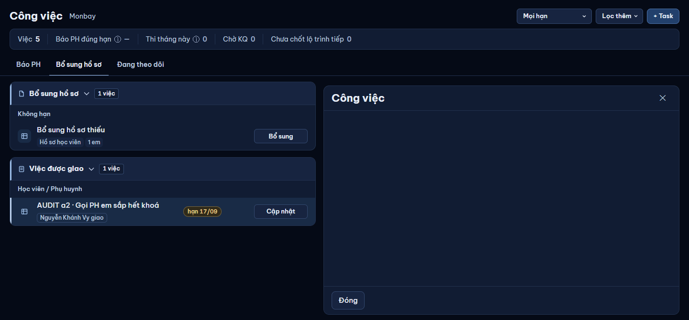
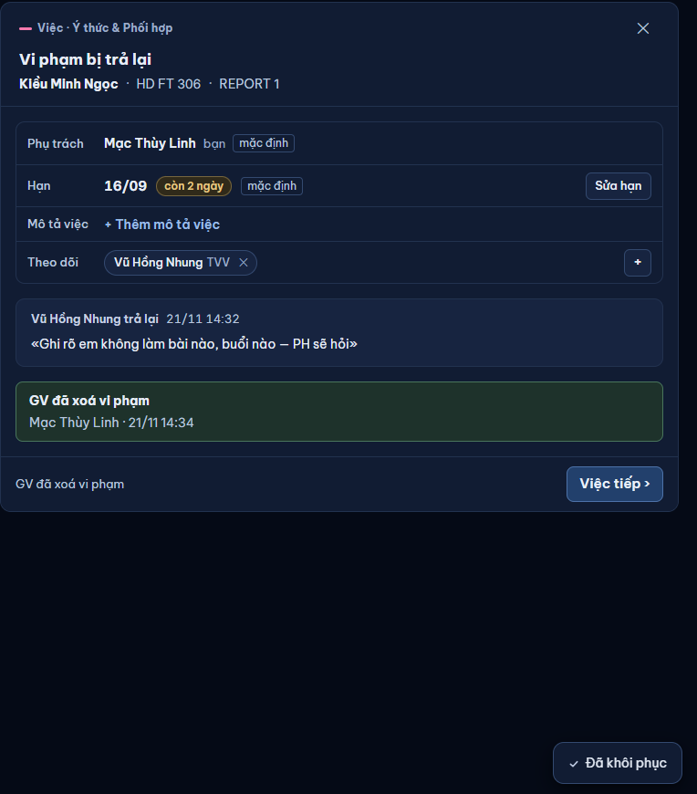
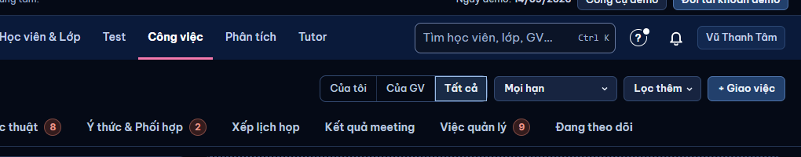
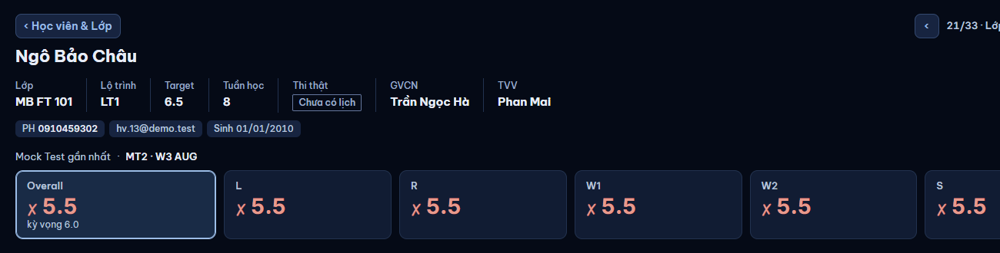
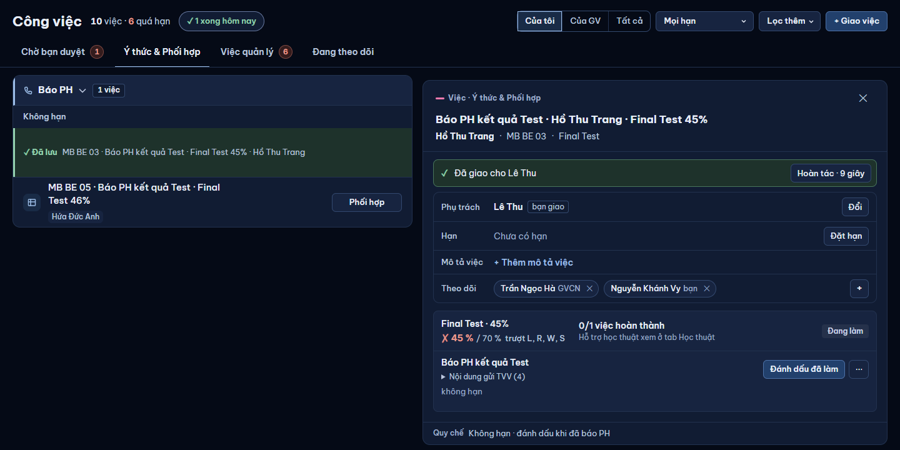
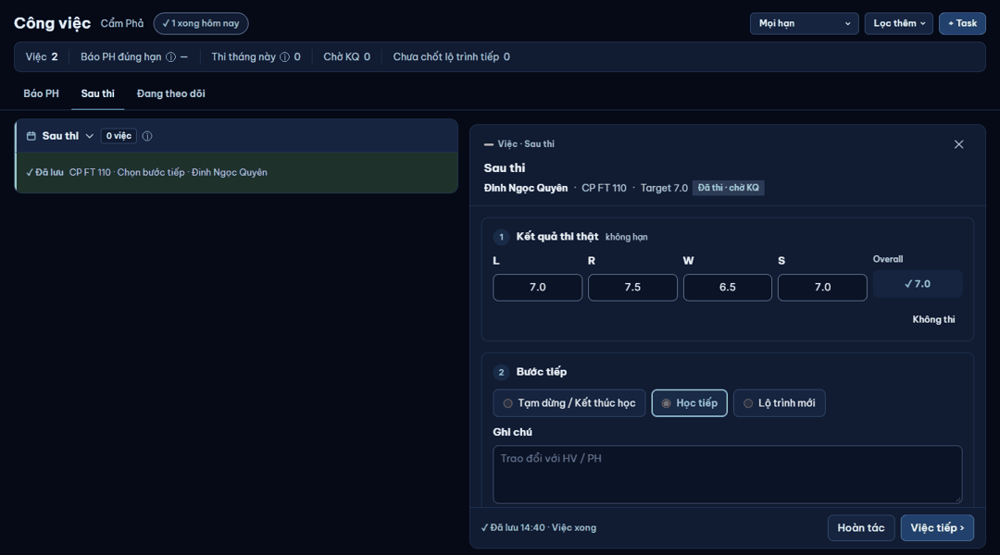
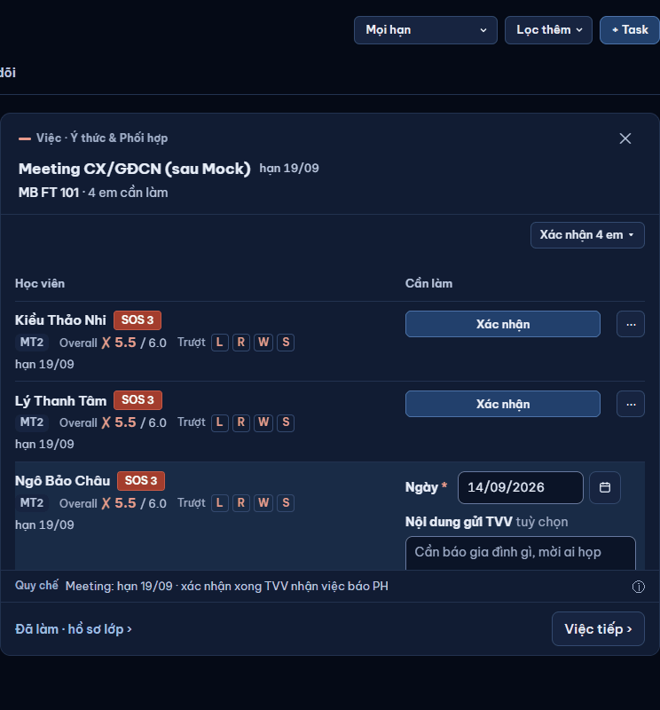
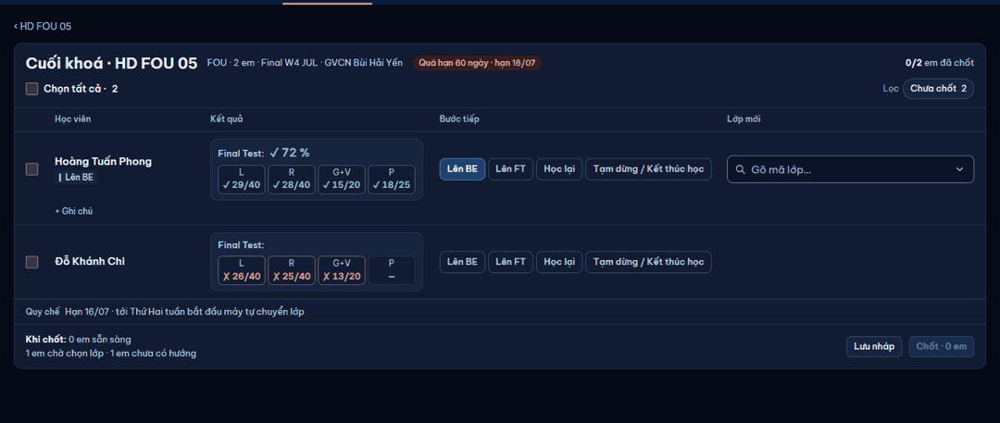

# AUDIT TOÀN BỘ 21/11 — giao diện · luật · logic · workflow

Chủ SP 21/11 tối: "Giao audit, critique, rà soát lỗi logic, lỗi UI/UX một lần nữa ở khắp mọi nơi đi"

Bản này **chỉ rà + đề xuất, không sửa mã**. Mã: `main` 5e395542b (sau #1944, hết đợt BPXL / giao việc / Vận hành / trả lại vi phạm). Seed, ngày demo 14/09/2026 (thứ Hai). Ảnh chỉ tài khoản demo, tên giả.

## 0. Tóm tắt một trang

**Đếm (sau khi gộp trùng giữa các nhóm):** P0 **1** · P1 **10** (1 là HỎI) · P2 **khoảng 75**. Có 11 câu hỏi cho chủ SP (mục 5).

**P0 duy nhất:** người đã **giao việc** rồi **mất vai ở chi nhánh** vẫn xem, sửa hạn, thêm người theo dõi và Hoàn tác việc của chi nhánh cũ. Tệ hơn, máy chủ trả lỗi 403 nhưng đã ghi xong (P0-01). Phần quyền còn lại đúng hết: 16 tài khoản, mọi vai, thử bằng API (b1 Phụ lục B). Không có lỗi console. Không request lỗi ở màn đọc. Không màn nào tràn ngang ở 375. Không còn chữ "xếp lại" sau vắng. Tên HV không bị cắt ở chỗ nào đã đo.

**Phần mới từ 16/11 chạy đúng phần lớn:** BPXL (N57), giao việc liên phòng ban + Meeting ba phần (N58), Vận hành (N59), gập / mở (N60), trả lại vi phạm (N61), việc tay vào hạng mục (N62). Số việc khớp nhau ở badge · chuông · đầu trang · hồ sơ GV · hồ sơ lớp · Lớp của tôi. Lỗi tập trung ở **mép** của phần mới: người không còn vai, TVV làm người nhận, Hoàn tác / khôi phục, chữ Hướng dẫn.

**Ba việc nên làm trước (đều nhỏ, không cần mockup, không tăng đọc Turso):**
1. **Quyền của việc được giao.** Một hàm kiểm "người giao còn hoạt động + còn vai" dùng chung cho 6 chỗ (P0-01). Cho người nhận / người theo dõi mở được việc Vận hành dù vai không có khu Công việc; nay TVV được giao thì panel trắng (P1-01).
2. **Hoàn tác / khôi phục phải trả lại như cũ.** Xoá vi phạm bị trả lại rồi Hoàn tác, việc của GV mất hẳn (P1-03). Khôi phục HV từ Thùng rác gắn người theo dõi / mô tả sang việc của em khác (P1-04). Gửi thân thiếu trường là kết thúc hết phân công GV của lớp (P1-05).
3. **Chữ / trạng thái nói sai người, sai việc.** Giao việc cho người khác lại báo "1 xong hôm nay" (P1-02). Học tiếp xong panel ghi "Đã thi · chờ KQ" (P1-07). Hướng dẫn "?" và câu Xác nhận Meeting vẫn ghi "TVV xếp họp" (P1-08, P1-09). Hồ sơ HV của CX không thấy việc của chính CX (P1-06).

**Bốn câu cần chủ SP trả lời trước (7 câu nhỏ ở mục 5):**
1. CX có được **chốt lộ trình Cuối khoá / Xét lại** không? Nay làm được vì có quyền sửa lớp. *(khuyến nghị: không — CX chỉ xem Cuối khoá, giữ chuyển lớp lẻ)*
2. BPXL có được **Xoá / Khôi phục lượt MT và kỹ năng chưa có điểm** không? N57 ghi "không huỷ / khôi phục lượt", mockup v22 ghi "GIỮ". *(khuyến nghị: được, khi chưa có điểm; sửa chữ N57)*
3. Việc Vận hành giao cho **chính Head / QT / CX** có vào "Việc của tôi" và số đếm không? Nay chỉ nằm ở bảng Vận hành, quá hạn mà không ai nhắc. *(khuyến nghị: có)*
4. CX mở Công việc: mặc định **"Của tôi"** khi CX có việc riêng (Kết quả meeting, việc được giao)? *(khuyến nghị: có)*

**Cách đọc cột "Rà":** ✓ = PTA Audit đã tự đọc lại mã / gọi lại API / xem ảnh · ○ = nhóm con báo kèm ảnh hoặc file:dòng, chưa rà lại lần hai.
**Loại:** LỖI = lỗi đã kiểm · ĐX = đề xuất · HỎI = câu hỏi cho chủ SP.

## 1. Cách làm

- **6 nhóm song song** (Opus 5.5 · high), mỗi nhóm 2 vòng, mỗi nhóm một tệp chi tiết có ảnh + file:dòng. Phạm vi: [a1](chi-tiet/a1.md) GV · GVCN · GV Speaking · Head tutor · [a2](chi-tiet/a2.md) QL · Quản trị · Admin · [a3](chi-tiet/a3.md) TVV · CX · BPXL · Meeting · hồ sơ HV · Hướng dẫn · [b1](chi-tiet/b1.md) quyền · đường lui · mất dữ liệu (API mọi vai) · [b2](chi-tiet/b2.md) số liệu cùng nguồn + Turso · [b3](chi-tiet/b3.md) workflow đếm bước.
- **Bốn máy chủ demo** (`PISA_DEM_SQL=1`): một seed nguyên chỉ đọc. Hai bản chép được ghi: một cho a1–a3, một cho b1 + b3. Một seed riêng để b2 đo dòng đọc mà không lẫn request của nhóm khác. Playwright chạy bằng Edge (bản chromium tải về của repo không chạy được trên máy này). Phông Be Vietnam Pro đã kiểm `document.fonts` trước khi chụp. Cỡ 1440 tối + 375 sáng mọi màn chính; 1280 cho Tổng quan, Công việc.
- **Đã bấm thử thật (ghi được):**
  - Giao việc tay vào hạng mục và vào nhóm tự đặt; việc lặp lại + việc con + tệp; Dừng lặp.
  - Đổi người phụ trách / Về mặc định / Hoàn tác / hai phiên cùng lúc; sửa hạn, sửa mô tả.
  - Trả lại vi phạm trọn vòng: Sửa rồi gửi lại · Giữ nguyên · Xoá + Hoàn tác · cả lần xử lý.
  - Meeting ba phần: BPXL Xếp lịch họp → TVV nhập hộ Kết quả → CX xem. Học tiếp. Xác nhận xử lý Mô tả trống.
  - Bỏ vai / khoá tài khoản đang được giao việc. Xoá HV → tạo việc → khôi phục HV (bẫy id dùng lại).
- **Skill đã chạy thật:**
  - `impeccable` critique + audit ở 3 nhóm giao diện, chạy rút gọn trong một ngữ cảnh. Critique 27–28 / 40, audit 14–15 / 20, detector 0–1 cảnh báo.
  - `ui-ux-pro-max` · `web-design-guidelines` · `karpathy-guidelines`.
  - Gợi ý trái luật đã bỏ: "Title Case cho nút", "hỏi xác nhận trước khi xoá" (trái luật Hoàn tác), cảnh báo "side-tab" ở vạch mục Cuối khoá (mẫu đã duyệt).
- **PTA Audit tự rà lại** P0 + mọi P1 (đọc lại mã, gọi lại API A2-01) trước khi đưa vào đây. **Đã gộp 6 cặp trùng**:
  - A2-01 = B3-01 · A2-02 = B3-03 · A1-01 = B1-10 · A3-01 = B3-10 · A2-03 = B3-07 · A2-05 = B3-02.
  - Hai nhóm tìm độc lập, nên tin được.
- **Đã hạ / đổi mức:**
  - B3-02 (việc giao cho TVV nằm ở tab Bổ sung hồ sơ): b3 chấm P1 → **P2**. Việc vẫn thấy, vẫn đếm đúng, chỉ sai tab.
  - Gộp B1-05 (BPXL khôi phục kỹ năng) với A3-17 (BPXL Xoá MT) thành **một câu hỏi** (câu 2): hai nhóm đề xuất ngược nhau cho cùng một quyền.
- **Đã loại vì báo sai** (chi tiết ở mục 5 của từng tệp):
  - Hạn trả lại 16/09 khác mockup 17/09: mã đúng quy ước "ngày trả là ngày 1".
  - Badge tab Chấm Speaking là số bài: đúng GD-4a.
  - BPXL không có badge khi có 1 việc: badge = quá hạn + hôm nay.
  - Head + CX tự vào Theo dõi Báo PH vi phạm: đã chốt TD-HEAD-CX.
  - "Hồ sơ lớp gọi roster hai lần": do StrictMode bản dev.
  - "Head › Ý thức hai nhóm Báo PH": không tái hiện.
  - "Hai phiên sửa việc Vận hành không 409": do script không gửi phiên bản.
- **Chưa rà được:**
  - Khoá cuối tuần N15: ngày demo là thứ Hai, chỉ đọc mã.
  - Tin vắng gộp lớp × tuần trong chuông BPXL: seed không có vắng đã chốt, chỉ đọc mã.
  - Cuối khoá cả lớp "Ngay hôm nay" + Hoàn tác, + Case → PA → Hoàn thành Case, Lộ trình mới: chỉ đọc mã.
  - N43 (Head tutor kèm vai GV): seed không có tài khoản như vậy.
  - N48 (GV lớp cũ xem 30 ngày), Chốt ngày thi bấm thật, PDF Báo cáo PH: chỉ đọc mã.
  - Rê chuột ở các luồng b3; 375 của b2.
  - Bàn phím ảo trên điện thoại thật.
  - Bản chính (chưa deploy).
  - `npm run check` không chạy lại: PTA Plan đã chạy xanh trên main 21/11, bản rà này không đổi mã.

## 2. P0 — 1 vấn đề

**P0-01 · Người giao việc đã mất vai ở chi nhánh vẫn sửa được việc chi nhánh cũ** — LỖI ✓ · [B1-01](chi-tiet/b1.md)
- **Thấy:** CX 24 giao Báo PH (Monbay) cho TVV 28. Sau đó Quản trị đổi vai 24 thành CX chỉ Bãi Cháy. 24 vẫn:
  - mở được khối giao việc (thấy tên HV, vi phạm, người theo dõi) trong khi hồ sơ HV đó trả 403;
  - đổi được hạn: máy chủ trả **403 nhưng đã ghi** (`viec_han_lan` 5, 6);
  - thêm được người theo dõi;
  - Hoàn tác được lần đổi người: **403 nhưng đã đảo** (audit 1094).
  Thử hai lần.
- **Vấn đề:** sai quyền (N58; chính chú thích `giaoViec.ts:9` "chỉ có hiệu lực khi còn hoạt động + còn vai"). Web báo "không được" trong khi đã đổi. Gốc: 6 chỗ so `giao_boi === p.userId` mà không kiểm còn vai: `giaoViec.ts:163, 172, 184, 345`, `baoPhTvv.ts:176`, `phoiHop.ts:655`. Riêng Mô tả (`:557`) đã kiểm đúng.
- **Đề xuất:** một hàm `laNguoiGiao(p, v)` = người giao **và** `hoatDongO` (như `coTheSuaMoTa` đang làm) dùng ở cả 6 chỗ. `hoanTacGiao`: người đã đổi cũng phải còn vai. Phép kiểm: người giao mất vai → 403 và không ghi.
- **Mockup:** không · **PR:** nhỏ, máy chủ, rà sâu `/security-review` · **Turso:** +1 câu chỉ ở đường ghi.

## 3. P1 — 10 vấn đề

### Nhóm A · Quyền + đường lui của phần mới (5)

**P1-01 · TVV được giao việc Vận hành mở ra panel trắng** — LỖI ✓ · [A2-01](chi-tiet/a2.md) = [B3-01](chi-tiet/b3.md)
- **Thấy:** Head giao việc Vận hành (và việc con) cho TVV 27 / 28. TVV bấm dòng → panel chỉ có tiêu đề + Đóng. PTA gọi lại `GET /api/mgmt-tasks/17`: TVV 27 → **403** "Vai trò của bạn không có khu Công việc."; CX 24 → 200.
  
- **Vấn đề:** trái N59 / N62 ("giao cho bất kỳ ai có tài khoản ở chi nhánh", người nhận làm được việc). TVV là người nhận việc Vận hành nhiều nhất. Gốc: cổng khu Công việc `routes/index.ts:161-176` chặn `/mgmt-tasks` với vai không có quyền vào khu Công việc; ngoại lệ chỉ có `/my-work` và `theo-doi`.
- **Đề xuất:** cổng cho qua `/mgmt-tasks/:id` (+ cập nhật tiến độ, việc con, tệp) khi người gọi là người phụ trách / phụ trách việc con / người theo dõi việc đó. Hàm dịch vụ đã tự kiểm "không được giao cho bạn". Không cấp quyền khu Công việc cho TVV.
- **Mockup:** không · **PR:** nhỏ (`routes/index.ts` + phép kiểm) · **Turso:** 0.

**P1-03 · Xoá vi phạm bị trả lại rồi Hoàn tác: việc của GV không trở lại** — LỖI ✓ · [A1-01](chi-tiet/a1.md) = [B1-10](chi-tiet/b1.md)
- **Thấy:** GV 32 chọn "Xoá vi phạm" ở việc bị trả lại → Hoàn tác "Đã khôi phục". Vi phạm có lại, nhưng:
  - yêu cầu trả lại vẫn "GV đã xoá vi phạm";
  - việc biến khỏi Công việc GV;
  - TVV đã nhận tin "GV đã xoá vi phạm";
  - Báo PH thôi tạm dừng, hạn bị dời 15/09 → 18/09.
  
- **Vấn đề:** N61 (Xoá khôi phục được) + luật "không khoá cứng: Hoàn tác trả lại như cũ". Gốc `yThuc/violations.ts:531-534`:
  - đóng yêu cầu ("da_xoa") **trước** khi chụp vào Thùng rác;
  - `donViec('tra_lai')` xoá thẳng người theo dõi / lịch sử / hạn / mô tả của yêu cầu, không chụp.
- **Đề xuất:**
  - Chụp yêu cầu + cờ tạm dừng Báo PH + 4 bảng việc **trước** khi đóng.
  - Hoàn tác / Khôi phục thì yêu cầu về "mở", Báo PH về "Chờ GV sửa".
  - Gửi TVV một tin "GV đã hoàn tác xoá".
- **Mockup:** không · **PR:** nhỏ (`violations.ts` + phép kiểm) · **Turso:** 0.

**P1-04 · Khôi phục HV từ Thùng rác gắn dữ liệu việc sang em khác** — LỖI ✓ · [B1-02](chi-tiet/b1.md)
- **Thấy:**
  1. TVV hỏi tình hình em 56; Head thêm người theo dõi + mô tả cho việc đó.
  2. Xoá HV 56.
  3. TVV hỏi tình hình em 115: id 1 được dùng lại.
  4. Khôi phục HV 56: việc của em 56 nhận id mới, còn người theo dõi + mô tả + lịch sử của em 56 khôi phục theo id cũ, nên **dính vào việc của em 115**.
  Người theo dõi sẽ nhận tin "Cập nhật" về em 115.
- **Vấn đề:** N28 (khôi phục "y như trước") + bẫy id dùng lại (bảng việc không AUTOINCREMENT). Gốc `platform/thungRac.ts:64-69`: danh sách liên kết mềm được ánh xạ id khi khôi phục chỉ có tệp, chuông, hành trình, yêu cầu duyệt. Thiếu `viec_theo_doi`, `viec_giao_lan`, `viec_han_lan`, `viec_mo_ta`, `ghi_dao` (loại `giao_viec`).
- **Đề xuất:** thêm 5 bảng đó vào danh sách, dùng ánh xạ loại → bảng đã có ở `giaoViec.ts:45`. Phép kiểm: xoá → tạo việc mới trùng id → khôi phục.
- **Mockup:** không · **PR:** nhỏ · **Turso:** 0.

**P1-05 · Gửi thân thiếu danh sách phân công là kết thúc hết GV của lớp** — LỖI ✓ · [B1-03](chi-tiet/b1.md)
- **Thấy:** `PUT /classes/6/teachers {teachers:'x'}` → **200**, kết thúc cả 5 phân công lớp MB FOU 12. Không 409, không trả khoá Hoàn tác (b1 đã trả lại bằng Phân công › Hoàn tác).
- **Vấn đề:** chống mất dữ liệu + bẫy "web cũ / thân cũ không được hỏng". Gốc `classes/classes.ts:1250`: `slots: input.slots ?? []` coi thiếu trường là "lớp không ai dạy"; phiên bản cũng tuỳ chọn.
- **Đề xuất:**
  - `slots` không phải mảng → 400 "Thiếu danh sách phân công".
  - Phiên bản bắt buộc ở đường này (web đã gửi).
  - Trả khoá Hoàn tác để toast có "Hoàn tác".
- **Mockup:** không · **PR:** nhỏ · **Turso:** 0.

**P1-06 · CX mở hồ sơ HV không thấy việc của chính mình** — LỖI ✓ · [B2-01](chi-tiet/b2.md)
- **Thấy:** em 58 có việc "Kết quả meeting" của CX. Công việc, badge, chuông của CX đều đếm việc này. Hồ sơ HV 58 của CX thì không có thanh việc: việc nằm ở "người khác" với chữ **"Chưa có người phụ trách"**. Lỗi giống hệt với việc người khác giao cho CX.
   
- **Vấn đề:** cùng nguồn Công việc ↔ hồ sơ HV; chữ nói sai người (N58). Gốc `students/viecHocVien.ts:309-315`: khối N52 chuyển mọi việc của CX sang "người khác". `/my-work` có ngoại lệ "việc giao cho CX / Kết quả meeting" (`mywork.ts:1904`), hồ sơ HV thiếu ngoại lệ này.
- **Đề xuất:** thêm đúng ngoại lệ đó vào `viecCuaHocVien` (một chỗ) + phép kiểm so hai đường.
- **Mockup:** không · **PR:** nhỏ · **Turso:** 0 (câu đã chạy).

### Nhóm B · Chữ / trạng thái nói sai (4)

**P1-02 · Giao việc cho người khác lại báo "✓ 1 xong hôm nay"** — LỖI ✓ · [A2-02](chi-tiet/a2.md) = [B3-03](chi-tiet/b3.md)
- **Thấy:** Head 2 (và TVV 27) Đổi → chọn người → Giao. Dòng thành "✓ Đã lưu", đầu trang hiện chip "✓ 1 xong hôm nay", dù việc chỉ chuyển người, chưa ai làm.
  
- **Vấn đề:** "không báo xong khi chưa xong" (CLAUDE.md); lọc "Xong hôm nay" đếm sai. Gốc `PanelViec.tsx:313, 524` truyền `onDaDoi={onDaLam}`.
- **Đề xuất:** khối giao việc gọi một hàm riêng "đã giao đi": tải lại danh sách, dải "Đã giao cho … · Hoàn tác", không qua bộ đếm "xong".
- **Mockup:** không · **PR:** nhỏ (`PanelViec.tsx`, `HoTroHocVienTab.tsx`) · **Turso:** 0.

**P1-07 · Học tiếp xong, panel Sau thi ghi "Đã thi · chờ KQ"** — LỖI ○ · [A3-01](chi-tiet/a3.md) = [B3-10](chi-tiet/b3.md)
- **Thấy:** TVV chọn Học tiếp (N51) → lưu (200). Panel vẽ lại với "Đã thi · chờ KQ", "Kết quả thi thật · không hạn", nút "Không thi". Hồ sơ em cùng lúc ghi đúng.
  
- **Vấn đề:** chữ nói sai trạng thái ngay sau lưu, người dùng tưởng lưu hỏng. Panel dựng lại từ lộ trình mới chưa có lịch thi.
- **Đề xuất:** sau lưu Học tiếp, panel giữ ảnh chụp lúc lưu: KQ đã ghi + "✓ Đã lưu · Học tiếp · Hoàn tác".
- **Mockup:** không · **PR:** nhỏ (`congViec/PanelSauThi.tsx`) · **Turso:** 0.

**P1-08 · Hướng dẫn "?" còn ghi "TVV xếp họp, ghi kết quả" và "BPXL / CX không có việc"** — LỖI ✓ · [A3-02](chi-tiet/a3.md)
- **Thấy:**
  - `shared/huongDan/cx.ts:37-38` "TVV của em báo PH, **xếp họp**, báo lại kết quả" · "Ghi kết quả là việc của TVV".
  - `tvv.ts:488, 500` cùng ý.
  - `cx.ts:86, 113, 115` "CX không có việc… Của tôi luôn trống".
  - `bpxl.ts:16, 104-105` "không có việc theo luật · Danh sách trống là bình thường".
- **Vấn đề:** trái N58 (Xếp lịch họp = BPXL, Kết quả meeting = CX) và N57 (BPXL có Xếp lịch họp).
- **Đề xuất:**
  - Viết lại 4 chỗ theo N58 (mục `meeting-phan` của `tvv.ts:70-79` đã đúng — dùng lại).
  - Thêm 3 mục còn thiếu cho TVV / CX: Trả lại vi phạm · Đổi người / hạn / theo dõi · Đang theo dõi (A3-14).
- **Mockup:** không · **PR:** nhỏ (`shared/huongDan/*` + EN) · **Turso:** 0.

**P1-09 · Xác nhận Meeting: câu tĩnh nói sai người** — LỖI ✓ · [A3-03](chi-tiet/a3.md)
- **Thấy:** GVCN bấm Xác nhận Meeting một em. Dưới form có câu "Lưu xong: việc cho **TVV** của em báo gia đình, **sắp xếp họp** (em chưa có TVV: bạn báo)." (`yThuc/BangPhoiHop.tsx:387`).
  
- **Vấn đề:** nói sai người (N58); lại là chú thích tĩnh (bỏ chú thích 07/11).
- **Đề xuất:** bỏ câu tĩnh. Dòng Quy chế ghi "xác nhận xong: BPXL xếp lịch · CX ghi kết quả · TVV báo PH".
- **Mockup:** không · **PR:** nhỏ · **Turso:** 0.

### Nhóm C · Câu hỏi quyền (1)

**P1-10 · CX chốt được lộ trình Cuối khoá** — HỎI ✓ · [A3-04](chi-tiet/a3.md) → câu 1 mục 5
- **Thấy:** CX mở Cuối khoá một lớp. Các nút Lên BE · Lên FT · Học lại · Tạm dừng / Kết thúc học · Chốt đều bật. Máy chủ `loTrinhTiep.ts:309, 443, 508` dùng `coTheRaLenh` = quyền sửa lớp. CX có quyền này từ N52 ("tạo / sửa lớp, chuyển lớp"). Chú thích `quyenChuyenLop.ts:5` vẫn ghi "chỉ Quản lý, Quản trị có", nay đã cũ.
  
- **Vấn đề:** N52 "KHÔNG sửa học thuật"; chốt Học lại theo điểm Final + Xét lại lộ trình là quyết định QL (OV-3b, N22 ①).
- **Đề xuất (nếu chủ SP đồng ý khuyến nghị):** tách quyền chốt lộ trình khỏi quyền chuyển lớp (bỏ vai CX ở đường chốt); CX chỉ xem Cuối khoá, giữ chuyển lớp lẻ.
- **Mockup:** không · **PR:** nhỏ · **Turso:** 0.

## 4. P2 — theo khu

Mỗi dòng: màn · vai → thấy gì → đề xuất. Chứng cứ đầy đủ (ảnh, file:dòng) ở tệp chi tiết theo mã. Mọi dòng **Turso 0**, **không cần mockup** trừ khi ghi khác.

### 4A. Giao việc · Vận hành · trả lại (phần mới)

| Mã | Rà | Loại | Hiện trạng đã kiểm | Đề xuất + lý do | PR |
|---|---|---|---|---|---|
| A2-05 = B3-02 | ○ | LỖI | Việc Head giao TVV vào nhóm tự đặt / không phân loại nằm ở tab **"Bổ sung hồ sơ"** (`tongQuan.ts:105-111` rơi về `bo-sung`) — N62 + mockup v22 V5: tab Vận hành | Thêm tab "Vận hành" cho TVV khi có việc được giao (như GV) | nhỏ |
| A2-03 = B3-07 | ○ | LỖI | Ô Hạng mục có **hai mục cùng tên "Báo PH"** (`bao-ph`, `bao-ph-test` — `tongQuan.ts:166, 169`) | Gộp một mục "Báo PH", máy chủ quy về khoá theo vai người nhận | nhỏ |
| A2-04, A2-09 | ○ | LỖI | Vận hành: Đổi người → Hoàn tác thì người phụ trách cũ bị thêm vào Theo dõi; người đó nhận 2 tin "Đổi người phụ trách" dù kết quả không đổi | Hoàn tác bỏ dòng theo dõi vừa thêm (dùng chung lọc của `giaoViec.ts`); xoá tin vừa tạo | nhỏ |
| B3-04 | ○ | LỖI | "Về mặc định" không có Hoàn tác (đổi sang người khác thì có) | Cùng dải "✓ … · Hoàn tác" | nhỏ |
| B3-05 | ○ | LỖI | Gõ "Mô tả việc" rồi bấm Đóng panel: chữ mất, không hỏi (`KhoiGiaoViec.tsx:167-215`) | Đi qua cơ chế "Bỏ chữ đang gõ?" chung của panel | nhỏ |
| A1-03 | ○ | LỖI | Việc đã đóng vẫn cho "Sửa hạn", "+ Thêm mô tả", ✕ / + người theo dõi, chip "còn 2 ngày" | Việc không còn mở → khối Phụ trách · Hạn · Theo dõi chỉ đọc | nhỏ |
| B3-12 | ○ | ĐX | Xong một việc Vận hành được giao = 4 bấm (Cập nhật → Cập nhật tiến độ → Xong → Lưu), toast không Hoàn tác, nút "Xong" trong khi Quy chế ghi "Hoàn thành" | Nút "Hoàn thành" một bấm + Hoàn tác (như Xếp lịch họp) | nhỏ |
| B3-14 | ○ | ĐX | "+ Việc con" mở với người "Chưa giao" | Mặc định người phụ trách của việc cha | nhỏ |
| B3-16, A2-14 | ○ | LỖI | "{tên} giao" lặp hai lần trong panel · form giao: dòng tĩnh "(bạn) tự theo dõi" thay vì chip "bạn" như mockup V2 | Giữ chip trong khối Phụ trách; người giao là chip trong ô Theo dõi | nhỏ |
| A2-10 | ○ | ĐX | Một khái niệm ba tên + hai trần: "Mô tả" 2000 ký tự (Vận hành), "Mô tả việc" 500 (khối N58), "Ghi chú" (giao GV theo lớp) | Một nhãn "Mô tả việc", một trần 500; chữ cũ dài giữ như N35 | nhỏ |
| A2-06 | ○ | LỖI | Bảng Vận hành: lọc Nhóm là ô chọn gốc (danh sách dài, trái N45); dòng Tạm ngưng cắt "…cần: —" | Ô Nhóm dùng ô có tìm (`OHangMuc`); bỏ "cần: —" khi trống | nhỏ |
| A2-13 | ○ | ĐX | Hai nút "+ Giao việc" (đầu trang N62 và cuối tab Việc quản lý) | Bỏ nút cuối tab | nhỏ |
| B2-06 | ○ | LỖI | Việc tay có HV liên quan: dòng Công việc không ghi tên em; hồ sơ HV của em không có việc | Dòng phụ tên em; thêm vế Vận hành lọc theo HV vào câu UNION sẵn có | nhỏ–vừa · +0 câu |
| A3-07 | ○ | LỖI | Trả lại / Rút: dải "✓ Đã trả lại · Hoàn tác" nằm đầu thân panel, không cuộn tới → khuất; thẻ bước ③ ghi "hạn 18/09" trong khi khối Hạn ghi "tạm dừng" | Cuộn lên dải sau lưu; thẻ ③ ghi "hạn tạm dừng" | nhỏ |
| B1-11 | ○ | ĐX | GV "Sửa rồi gửi lại" / "Giữ nguyên" không có Hoàn tác | Toast Hoàn tác 60 s như Trả lại | nhỏ |
| B1-07 | ○ | LỖI | Người khác người trả bấm Hoàn tác trả lại → câu "Quá thời gian Hoàn tác" (sai lý do) | Tách câu: "Chỉ người trả lại hoàn tác được — dùng Rút yêu cầu" | nhỏ |
| B3-08 | ○ | ĐX | GVCN "Sửa rồi gửi lại" cả lần xử lý: câu chữ trơn "sửa ở tab Ý thức của em", không link → đổi trang 2 lần | Link "Mở tab Ý thức của em ›" (giữ panel) | nhỏ |
| A3-08, A3-09, A3-10, A3-11 | ○ | LỖI | Panel Meeting: chân "Việc tiếp ›" trước "Đóng" · dòng TVV thiếu "họp 18/09 15:00" (dòng CX có) · TVV thấy chính mình ở Theo dõi · giờ xong ghi giờ máy thật (21/11) thay ngày nghiệp vụ | Đóng trước · thêm giờ họp vào dòng TVV · lọc người phụ trách khỏi Theo dõi · `xong_luc` theo ngày nghiệp vụ | nhỏ |
| B1-08 | ○ | LỖI | Chuyển lớp sang lớp không có → **500** cho mọi vai (đọc lớp trước khi kiểm quyền); câu 403 thiếu CX | 404 "Không tìm thấy lớp chuyển đến"; câu "Head hoặc CX của chi nhánh…" | nhỏ |
| B1-09 | ○ | LỖI | Head nhập điểm em chi nhánh khác nhận câu dành cho GV (B1-14 cũ mới sửa phần Admin) | Câu theo `qlDiem` | nhỏ |
| B1-13 | ✓ | LỖI | Head ghi mốc Progress = 999 cho lớp FT → 200 (`schedule.ts:736-746`) | Lớp FT không có Progress / Final → 400 | nhỏ |

### 4B. CX · BPXL · TVV

| Mã | Rà | Loại | Hiện trạng đã kiểm | Đề xuất + lý do | PR |
|---|---|---|---|---|---|
| A3-05 | ○ | LỖI | CX thấy nút "Nhập điểm", panel tiêu đề "Nhập điểm…" nhưng không ô nhập, không câu vì sao | Người không nhập được: nút "Xem", tiêu đề "Điểm …", một dòng "Chỉ xem · GV / Head nhập" | nhỏ |
| A3-06 | ○ | LỖI | CX "+ Task › Tình hình học tập" ra mẫu **GV báo TVV** (vì CX có quyền ghi vi phạm), trái chú thích `board.ts:313` "CX hỏi như TVV" | CX dùng mẫu "Hỏi tình hình" như TVV | nhỏ |
| A3-15 | ○ | LỖI | Câu "Trang này dành cho: …" thiếu BPXL / CX (`App.tsx:436-444`) | Thêm vai mới | nhỏ |
| B2-12 | ○ | ĐX | BPXL "Bài chưa có điểm 74" (chỉ FT) ↔ Admin "Bài chưa nhập điểm 105" — hai tên, hai số cùng chi nhánh | Một tên + ⓘ phạm vi "Fast Track" | nhỏ |
| B3-15 | ○ | ĐX | BPXL sửa tuần khai giảng / Progress / Final lớp thường phải đổi trang (tên lớp → ⋯ → …) | Hộp sửa mốc mở ngay ở hàng lớp Kế hoạch Test | nhỏ |
| A3-12 | ○ | LỖI | "Chưa chốt lộ trình tiếp" (1440) ↔ "Chưa chốt bước tiếp" (375) — một khái niệm hai tên | Một tên "Chưa chốt bước tiếp" | nhỏ |
| A3-13, B3-11 | ○ | LỖI / ĐX | Dòng Sau thi lặp "Đã xong · … · Đã có kết quả · Chưa chốt bước tiếp" (3 lần với đầu panel, chân); chọn Học tiếp vẫn phải lưu 2 lần (RA đề xuất 4 mới làm một phần) | Dòng = tên em + "OVR · Đạt Target"; một nút lưu cả điểm + bước tiếp | nhỏ |
| B1-06 | ○ | HỎI | TVV của em vẫn ghi Báo PH sau khi việc đã giao cho người khác → câu 9 mục 5 | — | — |

### 4C. Số liệu cùng nguồn

| Mã | Rà | Loại | Hiện trạng đã kiểm | Đề xuất | PR |
|---|---|---|---|---|---|
| B2-03 | ○ | LỖI | Hồ sơ lớp FT101 (GV 7): "17 việc" cạnh chip cộng 34 (Nhập điểm đếm bài) + badge tab Ý thức **3** (= số em) ↔ chip Ý thức 5 — [NGHI] cũ thành lỗi thật | Badge tab dùng cùng `badgeTab` Công việc; chip Nhập điểm thêm `title` "21 bài · 4 việc" | nhỏ |
| B2-08 = P1-07 cũ | ○ | LỖI | Hồ sơ lớp QL "Chờ chấm · 65 ›" → trang đích "15 việc" + "13 bài", không chỗ nào 65 | Ô ghi đơn vị việc như trang đích | nhỏ |
| B2-04 | ○ | LỖI | Lịch thi "Tất cả 43 · 4 chip đều 0" (em "Chưa có lịch" / dự kiến không thuộc chip nào) — [NGHI] cũ thành lỗi thật | Gộp vào chip "Chưa chốt ngày" | nhỏ |
| B2-05 = C3 cũ | ○ | LỖI | Phân tích › Ý thức: thẻ "↓3" cạnh bảng một lớp "↑3"; dòng gộp "1 lớp khác" không có cột ± | Dòng gộp hiện ± | nhỏ |
| B2-07 | ○ | LỖI | Badge Chấm Speaking = số bài, tab khác = số quá hạn (P2 số 12 cũ) | Badge = số bài **quá hạn**, tổng ở `title` (vẫn không cộng menu, lời 33) | nhỏ |
| B2-10 | ○ | ĐX | 4 em có "Nhập điểm MT cũ" ở Công việc, không có ở thanh hồ sơ HV (P1-04 cũ còn sót) | Thêm `lich-su:{lớp}` cùng câu sẵn có | nhỏ · +0–1 câu |
| B2-11 | ○ | LỖI | Badge "Chờ bạn duyệt" rê chuột "trong 10 việc", nơi khác "10 yêu cầu" | `chuBadgeTab` nhận đơn vị | nhỏ |
| A1-02 | ○ | LỖI | Hồ sơ GV: rê chuột badge tab "8 quá hạn trong 8 việc", thật 32 việc (`HoSoGiaoVienPage.tsx:159`) | `n` = tổng việc | nhỏ |
| P1-05 cũ | ○ | LỖI | Link tên GV đã mang kỳ (đã sửa), nhưng Tổng quan và Phân tích GV vẫn mặc định hai kỳ lệch 1 tuần | Một kỳ mặc định chung | nhỏ |

### 4D. Hiển thị · chữ cắt · lệch mockup

| Mã | Rà | Loại | Hiện trạng đã kiểm | Đề xuất | PR |
|---|---|---|---|---|---|
| A1-05 | ○ | LỖI | Khối "PA đang chạy": tên dòng = nội dung PA gõ tay, xuống **4 dòng** ở 1440, cắt "…" ở 375 — lệch mockup v21 D1 ("Lớp · Bổ trợ Reading") | Tên dòng = "Lớp · loại PA + kỹ năng"; bỏ `truncate` quanh tên HV (`PaDangChay.tsx:90-92`, còn sót T5) | nhỏ |
| A1-04 | ○ | LỖI | Lỗi tại ô bị chân panel che, chỉ thấy "Còn 1 ô cần sửa ↑" | Bấm nút chính khi còn lỗi → cuộn ô lỗi đầu vào giữa thân panel (một chỗ `ui/loiForm.tsx`) | nhỏ |
| A1-06 | ○ | LỖI | Hồ sơ GV của chính GV vẫn "‹ Tổng quan" (A1-08 cũ còn) — `quayLai.ts:90` | Vai không có Tổng quan → "‹ Công việc" | nhỏ |
| A1-07 | ○ | LỖI | Lớp của tôi cột Test lẫn "Progress" với "Progress Test" | Một bảng tên ngắn như mockup K1 | nhỏ |
| A1-08 | ○ | LỖI | Xác nhận Case: "đến Cuối khoá" lặp; chân "Tiếp: … · Đặng / Quốc Bảo" tên HV gãy 2 dòng (N55) | Bỏ đoạn lặp; "Tiếp: {tên em} ›" một dòng | nhỏ |
| A1-09 | ○ | ĐX | Ô Môn: panel ghi vi phạm là ô thả, panel trả lại là chip | Chip ở cả hai | nhỏ |
| A1-10 | ○ | LỖI | Hồ sơ HV: chip "**Kỳ**" trống nghĩa (tách "Kỳ W4 AUG – W1 SEP" thành 3 chip) | Giữ nguyên một chip "Kỳ W4 AUG – W1 SEP" | nhỏ |
| A1-12 | ○ | ĐX | Hồ sơ lớp GV: "Chờ chấm · 21 ›" và chip "Nhập điểm · 21" cách 40 px (A1-09 cũ còn) | Bỏ ô dải số với GV | nhỏ |
| B3-06 | ○ | LỖI | Panel Phối hợp SOS gom em: nút "Bỏ việc…" bị cắt ở cột 40 px (do #1881 đổi ⋯ một mục thành nút chữ) | Cột theo nội dung, hoặc giữ ⋯ ở cột hẹp | nhỏ |
| A2-07 | ○ | LỖI | "Final / Test 45%" xuống dòng giữa cụm dù cột còn chỗ | `nowrap` cụm kết quả / dòng phụ | nhỏ |
| A2-11, A2-17 | ○ | LỖI | 375: Phân tích › Theo lớp nhãn "60–69 %" nằm dưới số khác, ⓘ rơi dòng · Tổng quan thẻ lớp số lệch hàng (A2-07 cũ còn) | Hai hàng rõ như thẻ Cuối khoá vừa sửa; căn số theo đáy | nhỏ |
| A2-12 | ○ | LỖI | Hồ sơ lớp: hai thứ tự kỹ năng ("L, R, S, W1, W2" vs "L, R, W1, W2, S"); "S›" dính chữ; dải số trống vẫn có khung | Một thứ tự L R W1 W2 S; cách trước "›"; ẩn khung trống | nhỏ |
| A2-18 | ○ | LỖI | Phân công GV 375: tên GV cắt "…" | Xuống dòng phụ như N55 | nhỏ |
| A3-18 | ○ | LỖI | 375: tab hồ sơ HV "Ý thức & / Phối hợp" 2 dòng; HV & Lớp tab "Lịch thi 23" cắt mép (A3-13 cũ một phần) | Nhãn ngắn 375 (`aria-label` đủ); 3 tab chia đều | nhỏ |
| A3-16 | ○ | LỖI | EN: "51 HV" không dịch, "1 students", một người ba tên (Core teacher / HRT / Homeroom), `hdV3c.ts:183` "CX cannot" ngược bản Việt, ⋯ rơi dòng ở 375 | Một bảng tên EN; sửa câu CX | nhỏ |

### 4E. Ngưỡng · chữ một nguồn · Turso · tài liệu

| Mã | Rà | Loại | Hiện trạng đã kiểm | Đề xuất | PR |
|---|---|---|---|---|---|
| B1-12 | ○ | LỖI | N50 ⑥ đã làm (một hằng 8), còn số 8 ghi tay ở `cases.ts:4148, 4848`, `tutors/trang.ts:364`, `tutor/kieu.ts:45` + khoá dịch EN chết "10 / 15 ký tự" | Đổi sang `CHU_TOI_THIEU`; xoá khoá chết | nhỏ |
| B2-13 | ○ | ĐX (Turso) | Tab Đang theo dõi duyệt mọi dòng `viec_theo_doi` từng có → tăng mãi (Báo PH vi phạm tự thêm 4 người) | Quét nền dọn dòng của việc đóng > 30 ngày | nhỏ |
| B2-14 | ○ | ĐX (Turso) | Trần `tocDoDuong.ts` không bắt được tăng thật: vai TVV đo bằng TVV Cẩm Phả ít em (trần 124 dòng ↔ TVV Monbay 601; 357 ↔ 2 403); hồ sơ lớp đo một URL gộp trong khi trang gọi hai; `students/:id` 72 / 76 và 77 / 84 câu (sát trần) | Đo TVV bằng TVV đông em nhất; đo đúng hai URL hồ sơ lớp | nhỏ |
| PTA-01 | ✓ | LỖI (tài liệu) | `plan.md` N56 còn "mã CHƯA làm" (đã làm #1876 #1878–#1882); N40–N45 "mã ĐÃ làm … đừng coi là đã chạy" tự mâu thuẫn · Rulebook §22 chỉ tới dòng 8 (N54, N56) — **thiếu N46–N53, N55, N57–N62** (Rulebook là nguồn số 1 về nghiệp vụ, quyền) · `CODE_MAP.md:398` ghi BPXL "không bị giao việc" (trái N57 / N58); chưa có dòng cho giao việc (`giaoViec.ts`, `KhoiGiaoViec`, `TabTheoDoi`), trả lại (`traLai.ts`, `PanelTraLai`), Meeting (`PanelMeeting`, `meeting.ts`), gập / mở; dòng 339 Vận hành cũ · `quyenChuyenLop.ts:5` chú thích "chỉ Quản lý, Quản trị có `class.edit`" (CX đã có) | Một PR tài liệu do planning làm | nhỏ (tài liệu) |

## 5. Câu hỏi cho chủ SP

**Bốn câu cần trả lời trước:**

| # | Câu hỏi | Vì sao hỏi | Khuyến nghị |
|---|---|---|---|
| 1 | CX có được **chốt lộ trình Cuối khoá** (Lên BE / FT, Học lại, Chốt) và **Xét lại lộ trình** không? (P1-10 · A3-04) | Nay CX làm được vì N52 cho CX quyền sửa lớp, và đường chốt lộ trình dùng chung quyền đó. N52 lại ghi "không sửa học thuật" | **Không.** CX chỉ xem Cuối khoá; giữ chuyển lớp lẻ, tạo / sửa lớp như N52 |
| 2 | BPXL có được **Xoá / Khôi phục lượt MT và kỹ năng đã huỷ khi chưa có điểm** không? (A3-17 + B1-05 — hai nhóm đề xuất ngược nhau) | N57 ghi "không huỷ / khôi phục lượt MT"; mockup v22 (cùng ngày duyệt) ghi "Đã xoá · Khôi phục — GIỮ (BPXL xếp như Admin)"; mã nay: BPXL Xoá MT được, khôi phục kỹ năng được, khôi phục lượt không | **Được khi chưa có điểm** (đó là việc xếp lịch, có Khôi phục); lượt / kỹ năng đã có điểm thì không. Sửa chữ N57, và làm ba đường cùng một luật |
| 3 | Việc Vận hành giao cho **chính Head / QT / CX** có vào "Việc của tôi", badge, chuông không? (B2-02) | Nay chỉ nằm ở bảng Vận hành: Head có việc quá hạn 3 ngày mà không số nào nhắc; GV nhận việc giống vậy thì được đếm | **Có.** Vào "Việc quản lý › Việc được giao", đếm như GV; việc mình tạo cho người khác vẫn chỉ ở bảng. +0 câu, + vài dòng |
| 4 | CX mở Công việc: mặc định **"Của tôi"** khi CX có việc riêng? (A3-19 = B3-09) | Nay mặc định "Tất cả" (142 việc, 39 quá hạn của GV), việc của CX (Kết quả meeting) phải tự tìm | **Có.** Có việc riêng → "Của tôi"; không có → giữ "Tất cả" |

**Bảy câu nhỏ — nếu chủ SP không nói khác, PTA làm theo khuyến nghị:**

| # | Câu hỏi | Khuyến nghị |
|---|---|---|
| 5 | BPXL đang **xem** được Ý thức (vi phạm, tab Ý thức lớp), trong khi Case đã chặn xem — N57 ghi "Không: Case, Ý thức" (B1-04) | Chặn xem Ý thức như Case |
| 6 | Dải BPXL "Chưa xếp lịch MT" thật ra đếm **em chưa đủ MT**: xếp MT1 xong số không đổi (B3-13) | Đổi chữ "Chưa đủ lịch MT" (đổi tên ở N57) |
| 7 | "Báo PH kết quả Test" nằm ở "Của tôi" của Head (được đếm) nhưng khối ghi "Phụ trách: GVCN" (A2-15) | Giữ Head làm được (lời 11/11); khối ghi "Phụ trách {GVCN} · Head làm được" |
| 8 | Head không sửa / sắp / ẩn được 4 nhóm Vận hành khởi đầu ("dùng chung · Quản trị sửa"); mockup V4 vẽ Head làm được (A2-16) | Giữ như mã (đỡ lệch giữa chi nhánh); sửa ghi chú mockup V4 |
| 9 | TVV của em vẫn ghi Báo PH sau khi việc đã giao cho người khác (B1-06) | Giữ (quyền vai, như Head); chỉ sửa ⓘ khối Theo dõi cho khỏi nói "chỉ xem" với TVV của em |
| 10 | Chốt / Xét lại lộ trình không hiện ở thanh việc hồ sơ HV (B2-09) | Giữ như nay (quyết định cả lớp; `students/:id` đã sát trần câu) |
| 11 | Nhập bù Case cũ chọn "Tiến bộ rõ" vẫn bắt "Vì sao kết luận vậy" ≥ 8 ký tự (N56 ⑤ chỉ nói Hoàn thành Case) (A1-11) | Giữ bắt buộc ở nhập bù (ngày quá khứ không có dữ liệu chứng minh) |

## 6. Kiểm lại P1 cũ (AUDIT-1611 + RA-SAU-TUTOR)

| Mã cũ | Kết quả | Ai kiểm |
|---|---|---|
| 1611 P1-01, P1-02, P1-03, P1-06, P1-08 | ĐÃ SỬA (đo số ở mọi nơi) | b2, a1, a2 |
| 1611 P1-04 thanh việc hồ sơ HV | MỘT PHẦN — 12 em lệch → 4 em (B2-10); phía CX lỗi mới P1-06 | b2 |
| 1611 P1-05 ba bộ số GV | MỘT PHẦN — link mang kỳ đã đúng; kỳ mặc định hai trang còn lệch 1 tuần (4C) | a2, b2 |
| 1611 P1-07 ô số hồ sơ lớp | MỘT PHẦN — "Quá hạn · 14" khớp; "Chờ chấm · 65" chưa (B2-08) | a2, b2 |
| 1611 P1-09 Cuối khoá cả lớp Hoàn tác | ĐÃ SỬA (đọc mã `hoanTacChuyenNgay.ts:93-115`, chưa bấm) | b1 |
| 1611 P1-10, P1-15 / N46, P1-16, P1-12, P1-13, P1-14 | ĐÃ SỬA (bấm thử) | a1, a2, a3, b3 |
| 1611 P1-11 Báo tình hình sai người | ĐÃ SỬA (đọc mã) | a1 |
| 1611 4A B1-02 … B1-11, câu 5, N50 ⑥ | ĐÃ SỬA (B1-14 một phần → B1-09; N50 ⑥ còn vụn → B1-12) | b1 |
| RA T1, T3 | ĐÃ SỬA (đọc mã) | a1 |
| RA T2, T4 + N56 ⑥, C1, C2 | ĐÃ SỬA | a1, a2 |
| RA T5 tên HV cắt | MỘT PHẦN — `PaDangChay.tsx:90-92` còn `truncate` (A1-05) | a1 |
| RA C3 Ý thức ± | MỘT PHẦN (B2-05) | b2 |
| RA mục 4 đề xuất 1–15 | 1–3, 5–7, 9–14 ĐÃ LÀM · 4, 8 MỘT PHẦN · 15 CÒN (hai bản giao diện KQ thi thật) | b3 |
| N56 ① ② ③ ⑤ ⑦, N47, N51, N53 | ĐÃ LÀM, chạy đúng | a1, a2, a3, b3 |

## 7. Phần đang tốt — đừng sửa

- **Quyền:** 16 tài khoản × ~35 thao tác (b1 Phụ lục B): đúng hết, trừ P0-01.
  - BPXL không sửa điểm / HV / Case / vi phạm / phân công / Phân tích.
  - CX làm đủ phía TVV + lớp, không sửa học thuật (trừ câu hỏi 1).
  - Vận hành chỉ Head / QT / CX tạo; tệp chéo chi nhánh 403.
  - Trả lại đúng 4 vai.
  - Head chi nhánh khác 403 ở mọi đường mới.
- **Chống ghi đè:** hai phiên đổi người / sửa hạn / sửa mô tả / sửa việc Vận hành cùng lúc → một 200, một 409. Thân cũ của việc Vận hành vẫn chạy.
- **Bẫy:**
  - libsql thiếu tham số: không thấy câu lệch (đếm `?` ở 10 tệp mới).
  - Xoá dòng việc trong app đều gọi `donViec` (chỉ đường khôi phục Thùng rác sai — P1-04).
  - Bỏ vai người được giao → việc về đúng người theo luật, có lịch sử, không mồ côi.
- **Một nguồn đếm:** badge = chuông = đầu trang = Σ badge tab = hồ sơ GV ở mọi vai đo. Việc tay vào hạng mục, việc được giao, Xếp lịch họp, Vi phạm bị trả lại vào đúng mọi nơi. Đang theo dõi, khối PA đang chạy, dải 4 số BPXL **không** cộng vào số việc (N54, N57). Việc xong rời mọi nơi ngay.
- **Không N+1** ở `/my-work`, `theo-doi`, `giao-viec`, `mgmt-tasks`, `students/:id`, `giao-vien/:id`.
- **Giao diện mới khớp mockup v22:**
  - Panel GV trả lại (3 lựa chọn, nút chính đổi chữ).
  - Khối Phụ trách · Hạn · Mô tả · Theo dõi.
  - Trang đầu BPXL (dải số lặng, lọc + chip).
  - Gập / mở nhớ theo người + tab, mục gập vẫn "n việc · m quá hạn".
  - N56 ① vào thẳng form có dải "Bạn đang làm thay…".
  - N62 việc nằm đúng mục, nhãn "{tên} giao".
- **Hiển thị:** ✕ / ⋯ thẳng hàng (≤ 0,5 px, ~80 nút đo). 375 không tràn ngang. Mã tuần một dòng. Không chữ "xếp lại". "Toàn bộ" chỉ ở Phân tích. Không điều khiển trong tiêu đề bảng. Điểm luôn "7.0" (N53).

## 8. Dòng đọc Turso — số đo hiện trạng

b2 tự đo bằng bộ đếm câu của máy chủ trên seed (146 HV, 34 lớp), mỗi trang tải đầy đủ như F5. Bảng đủ ở [b2 mục "Số đo Turso"](chi-tiet/b2.md#số-đo-turso).

| Trang (mỗi lần mở) | 16/11 (đường · câu · dòng) | 21/11 | Đường nặng nhất nay |
|---|---|---|---|
| Hồ sơ lớp FT101 · QL | 12 · 194 · 5 059 | **7 · 166 · 3 544** | gộp `overview,roster,diemTheoLuot` 54 / 2 447 |
| Hồ sơ lớp FT101 · GV | 10 · 169 · 4 611 | **6 · 109 · 3 278** | như trên 55 / 2 466 |
| Hồ sơ HV · GV | 8 · 189 · 992 | 10 · 218 · 845 | `students/:id` **77 câu** (trần 84) |
| Hồ sơ HV · QL | 10 · 173 · 1 141 | 12 · 208 · 495 | `students/:id` **72 câu** (trần 76) |
| HV & Lớp · QL | 5 · 114 · 4 434 | 5 · 94 · 3 158 | `hoc-vien-lop?kem=sos-dem` 56 / 2 906 |
| Tổng quan · QL | 7 · 115 · 3 710 | 7 · 102 · 2 998 | `tong-quan/v5` 35 / 2 234 |
| Công việc · QL (Tất cả) | 5 · 112 · 2 064 | 4 · 86 · 1 185 | `my-work?nguoi=tat-ca` 50 / 939 |
| Công việc · GV | 2 · 45 · 760 | 2 · 43 · 620 | `my-work` 40 / 605 |
| **Mới:** HV & Lớp · CX | — | 5 · 91 · **6 284** | `hoc-vien-lop?kem=sos-dem` 62 / 3 950 |
| **Mới:** Tổng quan · CX | — | 5 · 60 · **5 304** | `tong-quan/v5` 36 / 3 168 |
| **Mới:** Hồ sơ GV · GV tự xem | — | 6 · 173–187 · 4 817–5 416 | `hai-khoi` 37–41 / tới 2 144 |
| **Mới:** Trang đầu BPXL | — | 4 · 27 · 485 | `tong-quan/mock-test` 14 / 231 |
| **Mới:** panel việc có khối giao việc | — | 4 · 26 · 29 | `giao-viec/bao_ph/:id` 11 / 13 |
| **Mới:** Đang theo dõi | — | `theo-doi` 2–4 câu / 1–12 dòng | — |

- **Giảm rõ từ 16/11** (gói 14 cũ đã làm): hồ sơ lớp −30 %, `/my-work` QL 39 / 866 → 30 / 212, Công việc QL −43 %.
- **Cảnh báo (> ~30 câu hoặc ~2 000 dòng):** `students/:id` 65–77 câu, sát trần; thêm một khối nữa ở hồ sơ HV là vượt. `hoc-vien-lop` của CX tới 3 950 dòng. `tong-quan/v5` tới 3 168. Gộp hồ sơ lớp 54–71 câu. `hai-khoi` tới 2 144.
- **Ước bản chính** (giả định dữ liệu ×3 seed, số người dùng tự đặt; bộ đếm đếm dòng trả về, Turso tính dòng quét nên thật cao hơn): **~8 triệu dòng / ngày ≈ 250 triệu / tháng**, dưới mốc 450 triệu. Hồ sơ lớp chiếm ~45 % phần GV + Head.
- **Hai chỗ bớt đọc rõ nhất (gói 10, đề xuất):**
  1. `diem-theo-luot` trả 410 byte nhưng kéo 831 dòng (đếm bằng JS) → đếm bằng `GROUP BY`. Ước −800 dòng trả về mỗi lần mở hồ sơ lớp (~−0,8 triệu / ngày); đo dòng quét trên bản chép trước khi làm.
  2. Hồ sơ GV tự xem: `hai-khoi` chỉ tải khi khối "Lớp chủ nhiệm" mở. Ước −1 700…2 100 dòng / lần.
- Không đề xuất nào trong bản này làm tăng câu, trừ B2-10 (+0–1 câu ở hồ sơ HV); B2-06, câu 3 chỉ thêm vài dòng.

## 9. Đề xuất chia PR (PTA Plan chọn thứ tự)

Không gói nào cần mockup mới (mọi đổi là đổi chữ / thêm nút theo mẫu / theo mockup v21–v22 đã duyệt). Gói 3 thêm tab Vận hành cho TVV theo mẫu tab của GV — cần ảnh trước │ sau.

| # | Gói | Gồm | Tệp chính | Cỡ | Model gợi ý · rà |
|---|---|---|---|---|---|
| 1 | **GIAO-VIEC-QUYEN** | P0-01, P1-01, B1-07, B1-08, B1-09 | `worklist/giaoViec.ts`, `yThuc/baoPhTvv.ts`, `yThuc/phoiHop.ts`, `routes/index.ts`, `permissions.ts` + phép kiểm | nhỏ | Opus · high · `/security-review` |
| 2 | **HOAN-TAC-DUNG** | P1-03, P1-04, P1-05, B1-11, B1-13, A2-04, A2-09, B3-04 | `yThuc/violations.ts`, `platform/thungRac.ts`, `classes/classes.ts`, `yThuc/traLai.ts`, `mgmttasks.ts`, `classes/schedule.ts` | vừa | Opus · high · `/code-review high` |
| 3 | **GIAO-VIEC-GD** | P1-02, A2-05 = B3-02 (tab Vận hành TVV), A2-03, A2-06, A2-10, A2-13, A2-14, B3-16, A1-03, B3-05, B3-12, B3-14, B2-06, A3-07, B3-08, mục Meeting A3-08…A3-11 | `congViec/PanelViec.tsx`, `KhoiGiaoViec.tsx`, `HoTroHocVienTab.tsx`, `MgmtTasksPage.tsx`, `PanelMeeting.tsx`, `yThuc/TraLai.tsx`, `shared/domain/tongQuan.ts` | vừa | Opus · medium |
| 4 | **CX-BPXL** | P1-06, P1-10 (theo câu 1), câu 2, 4, 5, 6, A3-05, A3-06, A3-15, B2-12, B3-15 | `students/viecHocVien.ts`, `classes/quyenChuyenLop.ts`, `loTrinhTiep.ts`, `fasttrack/absence.ts`, `fasttrack/attempts.ts`, `yThuc/access.ts`, `CongViecPage.tsx`, `App.tsx` | nhỏ–vừa | Opus · medium |
| 5 | **HUONG-DAN-CHU** | P1-08, P1-09, A3-14, A3-12, A3-16 (EN), B1-12, B2-11 | `shared/huongDan/{cx,tvv,bpxl}.ts`, `yThuc/BangPhoiHop.tsx`, `shared/i18n/en/*` | nhỏ | Sonnet · medium |
| 6 | **SAU-THI-GON** | P1-07, A3-13, B3-11, RA đề xuất 15 | `congViec/PanelSauThi.tsx`, `DanhSachViec.tsx` | nhỏ | Opus · medium |
| 7 | **SO-LIEU-4** | B2-03, B2-04, B2-05, B2-07, B2-08, B2-10, A1-02, P1-05 cũ (kỳ mặc định), câu 3 | `ClassOverviewPage.tsx`, `DauTrangLop.tsx`, `GocLichThi.tsx`, `YThucPhoiHop.tsx`, `Nhan.tsx`, `viecHocVien.ts`, `mywork.ts` | nhỏ–vừa | Opus · medium |
| 8 | **HIEN-THI-GV** | A1-04 … A1-10, A1-12, B3-06 | `PaDangChay.tsx`, `ui/loiForm.tsx`, `quayLai.ts`, `LopCuaToi.tsx`, `DanhSachViec.tsx`, `BangPhoiHop.tsx` | nhỏ | Sonnet · medium (ảnh trước │ sau) |
| 9 | **HIEN-THI-QL-375** | A2-07, A2-11, A2-12, A2-17, A2-18, A3-18 | `phanTich`, `TongQuanV5.tsx`, `DauTrangLop.tsx`, `ui/HangTab.tsx` | nhỏ | Sonnet · medium (ảnh 375) |
| 10 | **TURSO-5** | B2-13, B2-14, mục 8 hai chỗ bớt đọc | `cham/diemTheoLuot.ts`, `hai-khoi`, quét nền, `tests/tocDoDuong.ts` | vừa | Opus · high (đo trên bản chép trước → sau) |
| 11 | **TAI-LIEU** | PTA-01 + ghi câu trả lời mục 5 vào `plan.md` 1.6 | `plan.md`, Rulebook §22, `CODE_MAP.md`, `quyenChuyenLop.ts` chú thích | nhỏ | PTA Plan |

Gói 1 và 2 nên chạy trước (máy chủ, chống mất dữ liệu). Gói 4 chờ câu 1, 2, 4, 5, 6. Gói 3 và 8 cùng chạm `DanhSachViec.tsx` / `BangPhoiHop.tsx`, nên xếp nối tiếp, không song song.

## 10. Ghi chú cho PTA Plan

- Bốn DB thử (`data/audit-goc|ghi|b1|b2.sqlite`) chỉ nằm trong worktree này, gitignore; dữ liệu các nhóm đã đổi ghi ở mục 6 của từng tệp chi tiết. Dọn worktree sau khi PR này merge.
- Playwright của repo đòi chromium 1255 chưa tải về; bản 1248 có sẵn không chạy được trên máy (spawn UNKNOWN). Các nhóm chạy bằng Edge (`channel: 'msedge'`). Session sau cần ảnh cặp thì dùng Edge, hoặc `npx playwright install chromium` (cần hỏi chủ SP trước khi tải).
- Ảnh thô không commit (ở scratchpad của session); ảnh chọn ở `anh/` (59 ảnh cắt, ~1,8 MB).
